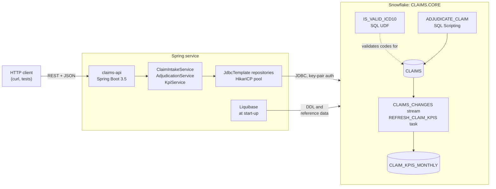
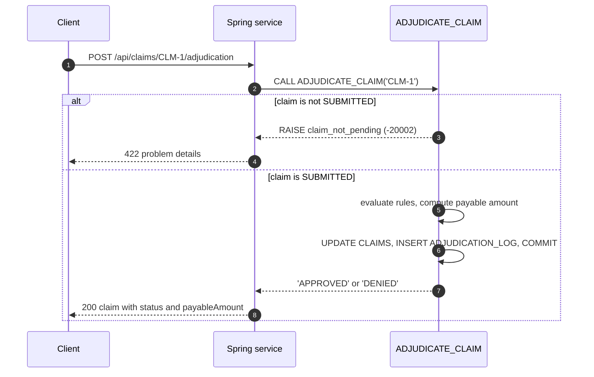

# Claims Service

A Spring Boot insurance-claims service built on the Snowflake JDBC driver, with SQL Scripting, a SQL UDF, streams and tasks. It is for Java backend engineers who want Snowflake in their integration tests: `./mvnw verify` runs the whole suite on a laptop with only Docker and JDK 21, against the LocalStack Snowflake emulator.

## Architecture



The business rules live in Snowflake, so the API, bulk loads and ad-hoc SQL all apply them from one implementation. The service connects as `SAMPLE_SVC` with role `CLAIMS_APP`, a least-privilege role that owns the `CLAIMS.CORE` schema and its objects; Liquibase migrates that schema at start-up, so the deployed objects always match the code. Design notes are in [docs/architecture.md](docs/architecture.md).

## How it works

1. **Provisioning.** An administrator runs `init/01_platform.sf.sql` once: warehouse `CLAIMS_WH`, role `CLAIMS_APP`, database `CLAIMS`, schema `CORE` and service user `SAMPLE_SVC`.
2. **Migrations.** Liquibase creates the tables, the `IS_VALID_ICD10` SQL UDF (one `REGEXP_LIKE` over the ICD-10-CM code structure), the procedure, stream, task and reference data.
3. **Submission** (`POST /api/claims`). One query checks the code with `IS_VALID_ICD10` and looks up the policy and provider; a `MERGE` inserts the claim unless the id already exists.
4. **Bulk intake** (`POST /api/claims/batch`). One JDBC batch into a staging table, one `UPDATE` that classifies every row, one `MERGE` of the accepted rows.
5. **Adjudication** (`POST /api/claims/{id}/adjudication`). `CALL ADJUDICATE_CLAIM(?)` applies the rules in priority order and records the decision in one transaction.
6. **KPIs** (`GET /api/kpis/monthly`). The task folds the stream's changes into the monthly KPI table every 5 minutes, or now with `POST /api/kpis/refresh`.



## Prerequisites

- Docker (with Compose v2 for `make up`)
- JDK 21 (Maven is not needed: `./mvnw` downloads it)
- A LocalStack auth token with Snowflake access, in `LOCALSTACK_AUTH_TOKEN` or `~/.localstack/default.env`
- `openssl` and `curl` for `make up` and the examples

## Quickstart

```sh
make up      # dev key in .secrets/, start the emulator on 127.0.0.1:4566 (SNOWFLAKE_PORT to change)
make seed    # migrate, load 300 synthetic claims, adjudicate 25, refresh KPIs
make run     # the service on http://localhost:8080
```

In a second terminal:

```sh
curl -s -X POST localhost:8080/api/claims -H 'Content-Type: application/json' -d '{
  "claimId": "CLM-DEMO-0001", "policyId": "POL-1001", "providerId": "PRV-201",
  "diagnosisCode": "E11.9", "serviceDate": "2026-02-10", "billedAmount": 1200.00}'
# 201 {"claimId":"CLM-DEMO-0001",...,"status":"SUBMITTED","payableAmount":null,...}

curl -s -X POST localhost:8080/api/claims/CLM-DEMO-0001/adjudication
# 200 {...,"status":"APPROVED","payableAmount":855.00,...}   (1200 - 250 deductible) x 0.90

curl -s -X POST localhost:8080/api/claims/CLM-DEMO-0001/adjudication
# 422 {"type":"urn:claims:problem:claim-not-pending",...,"snowflakeErrorCode":-20002}

curl -s -X POST localhost:8080/api/claims -H 'Content-Type: application/json' -d '{
  "claimId": "CLM-DEMO-0002", "policyId": "POL-1001", "providerId": "PRV-201",
  "diagnosisCode": "E11.", "serviceDate": "2026-02-10", "billedAmount": 1200.00}'
# 422 {"type":"urn:claims:problem:invalid-diagnosis-code","detail":"'E11.' is not a valid ICD-10-CM code",...}

curl -s -X POST localhost:8080/api/kpis/refresh   # 202, runs EXECUTE TASK REFRESH_CLAIM_KPIS
curl -s localhost:8080/api/kpis/monthly
# [{"serviceMonth":"2026-01-01","status":"APPROVED","claimCount":...},...]
```

Then stop the service and finish:

```sh
make test    # the full suite on its own Testcontainers emulator (does not need make up)
make down    # remove the emulator
```

## Tests

`./mvnw verify` (or `make test`) starts a fresh emulator in Testcontainers, provisions it with `init/01_platform.sf.sql`, migrates it with Liquibase and drives the service through its real HTTP API and JDBC driver:

- **Adjudication:** the payable amount from the policy terms, every rule in priority order and its boundaries (last covered day, one cent over the limit), and the audit row.
- **Bulk intake:** 250 claims loaded with one JDBC batch, each bad row reported with its row number and reason.
- **Error paths:** `422` for an invalid ICD-10 code or a claim adjudicated twice, `409` for a duplicate id, `404` for an unknown claim, with nothing written.
- **KPIs:** the stream and task move a claim between status buckets after `EXECUTE TASK`.
- **ICD-10 UDF:** `IS_VALID_ICD10` called directly with canonical, malformed and `NULL` codes.

To run the same suite against a Snowflake account (consumes credits), set `SNOWFLAKE_ACCOUNT`, `SNOWFLAKE_USER`, `SNOWFLAKE_PRIVATE_KEY_PATH`, `SNOWFLAKE_ROLE` and `SNOWFLAKE_WAREHOUSE` and run `make test-cloud`. It creates a `CLAIMS_IT_<random>` database, migrates it and drops it when the run ends; the role needs `CREATE DATABASE` and `EXECUTE TASK`.

## Project structure

```
claims-service/
  Makefile, docker-compose.yml   up, seed, run, test, demo, down, test-cloud
  init/01_platform.sf.sql        administrator provisioning: warehouse, role, schema, user
  claims-api/
    src/main/java/.../claims/    api, config, domain, repo, seed, service
    src/main/resources/          application.yml, Liquibase changelogs
    src/test/java/.../claims/    Testcontainers set-up and integration tests
  scripts/                       wait-for-emulator.sh, demo.sh, test-summary.sh
  docs/architecture.md           design notes
```

## Learn more

- [Snowflake JDBC driver](https://docs.snowflake.com/en/developer-guide/jdbc/jdbc) and [key-pair authentication](https://docs.snowflake.com/en/user-guide/key-pair-auth)
- [Snowflake Scripting cursors](https://docs.snowflake.com/en/developer-guide/snowflake-scripting/cursors) and [exceptions](https://docs.snowflake.com/en/developer-guide/snowflake-scripting/exceptions)
- [SQL UDFs](https://docs.snowflake.com/en/developer-guide/udf/sql/udf-sql-introduction) and [`REGEXP_LIKE`](https://docs.snowflake.com/en/sql-reference/functions/regexp_like)
- [Streams](https://docs.snowflake.com/en/user-guide/streams-intro) and [tasks](https://docs.snowflake.com/en/user-guide/tasks-intro)
- [Access control overview](https://docs.snowflake.com/en/user-guide/security-access-control-overview)
