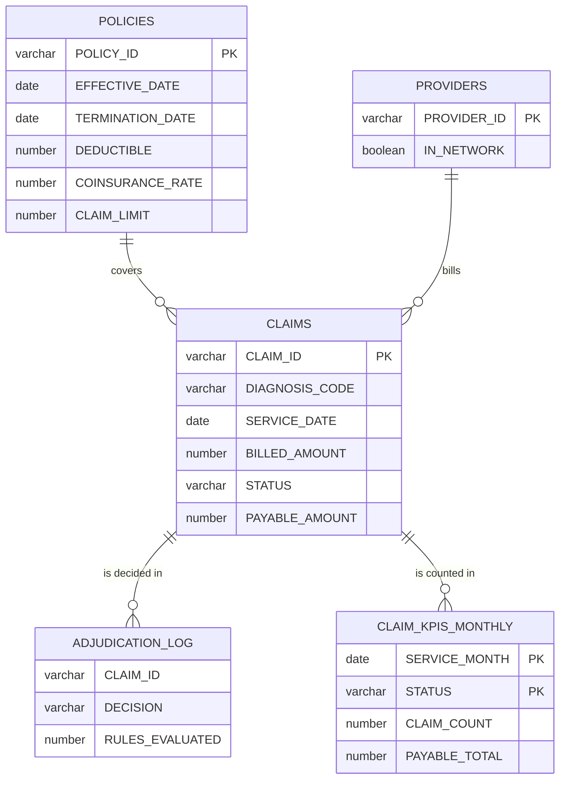

# Claims Service: design notes

How the [Claims Service](../README.md) divides work between Spring and Snowflake, and why.

## Responsibilities

| Layer | Owns |
| --- | --- |
| Platform (`init/01_platform.sf.sql`, run by an administrator) | Warehouse `CLAIMS_WH`, role `CLAIMS_APP`, database `CLAIMS`, schema `CORE`, service user `SAMPLE_SVC` |
| Liquibase (`claims-api/src/main/resources/db/changelog`) | Tables, the `IS_VALID_ICD10` SQL UDF, the `ADJUDICATE_CLAIM` procedure, stream, task, reference data |
| Snowflake at run time | Adjudication rules, ICD-10 validation, incremental KPIs |
| Spring service (`claims-api`) | REST API, request validation, error mapping, connection pool, bulk-intake transaction |

Rules live in Snowflake so that the single-claim path, bulk intake and ad-hoc SQL apply them from one implementation. The adjudication rules are rows in `ADJUDICATION_RULES`, so operations can disable one with an `UPDATE` instead of a deployment.

## Data model

Snowflake records primary keys but does not enforce them, so uniqueness of `CLAIM_ID` comes from how rows are written: a submission is one `MERGE ... WHEN NOT MATCHED THEN INSERT`, and a second request with the same id inserts nothing and becomes `409 Conflict`. Bulk intake stages the batch with `JdbcTemplate.batchUpdate`, classifies every row with one `UPDATE ... FROM` (invalid code, unknown policy or provider, duplicate id), merges the accepted rows and returns the rejected ones with their row numbers, all in one transaction.

## Adjudication

| Rule | Priority | Fails when | Denial reason |
| --- | --- | --- | --- |
| `POLICY_ACTIVE` | 10 | the service date is outside the policy period | `POLICY_INACTIVE` |
| `DIAGNOSIS_COVERED` | 20 | the code's category is in `COVERAGE_EXCLUSIONS` | `NOT_COVERED` |
| `WITHIN_CLAIM_LIMIT` | 30 | `BILLED_AMOUNT > CLAIM_LIMIT` | `OVER_CLAIM_LIMIT` |

An approved claim pays `max(billed - deductible, 0) x (1 - member share)`, where the member share is the policy's coinsurance rate, plus 0.30 (capped at 1) out of network.

- **Variables first, then the rules.** The procedure reads the claim and policy values once with `SELECT ... INTO`, then walks a declared cursor over the enabled rules; the first failing rule denies the claim.
- **A plain result.** It returns the decision as a `VARCHAR`; the service then reads the stored claim, so the API response is always the row as written.
- **It owns its transaction.** `BEGIN TRANSACTION ... COMMIT` wraps the `UPDATE` and the audit insert, and `EXCEPTION WHEN OTHER THEN ROLLBACK; RAISE;` undoes a partial write.
- **Concurrency guard.** The `UPDATE` repeats `STATUS = 'SUBMITTED'` and checks `SQLROWCOUNT`, so two concurrent calls cannot both decide one claim.
- **Errors by number.** Custom exceptions reach JDBC as `SQLException.getErrorCode()` with SQLSTATE `P0001`; the service maps `-20001` to 404 and `-20002` to 422 and never parses the message.

## Incremental KPIs

The `CLAIMS_CHANGES` stream returns the net change since its offset. A new claim is an `INSERT` row; an adjudication of a counted claim is a `DELETE` of the old image plus an `INSERT` of the new one. The `REFRESH_CLAIM_KPIS` task body is one `MERGE` that adds +1 per `INSERT` and -1 per `DELETE` to each (month, status) bucket, so a claim moves from `SUBMITTED` to `APPROVED` or `DENIED`; committing it advances the stream offset. The task is created suspended and resumed only under the Liquibase `scheduled` context; tests and `POST /api/kpis/refresh` use `EXECUTE TASK`, and tests poll for the result.

## ICD-10 validation

`IS_VALID_ICD10(CODE)` is a SQL UDF: `COALESCE(REGEXP_LIKE(CODE, '[A-Z][0-9][0-9A-Z]([.][0-9A-Z]{1,4})?'), FALSE)`. It accepts the canonical dotted ICD-10-CM form: a 3-character category (letter, digit, digit or letter), optionally followed by a dot and 1 to 4 more characters, such as `I10`, `E11.9` or `S93.401A`. `REGEXP_LIKE` matches the whole string, and `NULL` is `FALSE`. The single-claim check, the bulk-intake `UPDATE` and ad-hoc SQL all call it, and its changeset is `runOnChange`, so editing the rule redeploys it.

## Connection and authentication

- One HikariCP pool as `SAMPLE_SVC` with role `CLAIMS_APP`, the owner of `CLAIMS.CORE`; Liquibase migrates through the same pool at start-up. `CLAIMS_APP` holds only `USAGE` on the warehouse and database and `EXECUTE TASK`, and rolls up to `SYSADMIN` like any custom role.
- Key-pair auth (`SNOWFLAKE_JWT`): the private key is parsed into a `PrivateKey` and handed to the driver, so a secret manager can supply it the same way as a file.
- Every connection sets role, warehouse, database, schema, `QUERY_TAG` and `application`, and `validateDefaultParameters=true` fails fast on a bad role or warehouse.
- The driver's Arrow reader needs `--add-opens=java.base/java.nio=ALL-UNNAMED` on Java 17+; the build sets it for tests, `spring-boot:run` and `java -jar`.

## Moving to a real account

1. An administrator runs `init/01_platform.sf.sql` and registers `RSA_PUBLIC_KEY` on `SAMPLE_SVC`.
2. Start the service with `SPRING_PROFILES_ACTIVE=cloud`, the `SNOWFLAKE_*` variables (`application-cloud.yml`), and `CLAIMS_LIQUIBASE_CONTEXTS=default,scheduled` to run the KPI task every 5 minutes.
