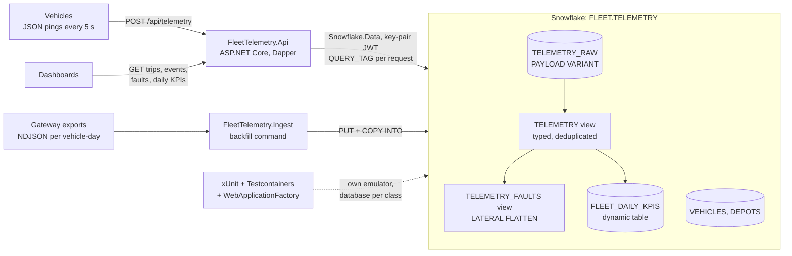
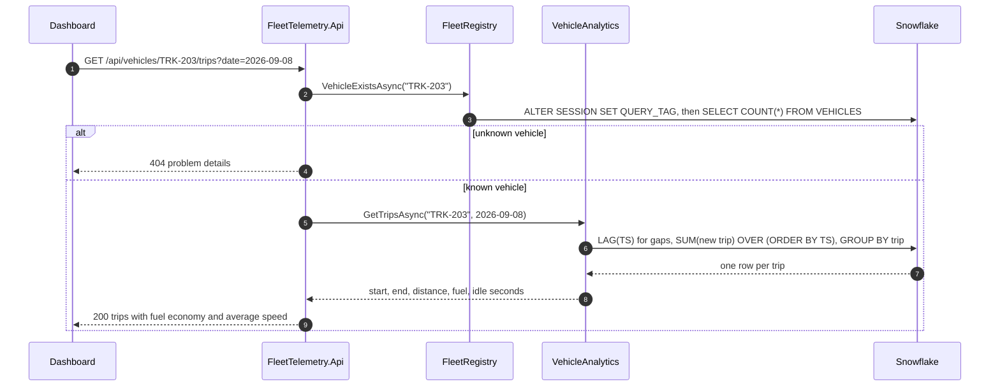

# Fleet Telemetry

A fleet telemetry service for a logistics company, built with ASP.NET Core minimal APIs on the official `Snowflake.Data` driver: vehicles post JSON pings with GPS, speed, fuel and engine diagnostics, and operations dashboards query trips, harsh braking, idling, fault codes and daily fleet KPIs. It shows how a .NET team develops and tests against Snowflake-Next on a laptop, with `dotnet run`, xUnit and Testcontainers.

## Architecture



Both ingestion paths land the device JSON unchanged in one `VARIANT` column. A typed view turns it into columns, the API's analytics are SQL over that view, and a dynamic table keeps the daily KPIs current without a scheduler.

## How it works

1. **Provisioning.** `init/01_platform.sf.sql` creates the warehouse `FLEET_WH`, the role `FLEET_APP`, the database `FLEET` and the service user `FLEET_SVC`. Files 02 to 05 create the landing table, the NDJSON file format and stage, the fleet registry, the typed views and the dynamic table. The emulator runs them all as init hooks.
2. **Live ingestion.** `POST /api/telemetry` takes a JSON array of up to 1,000 pings, validates every field (400 problem details otherwise) and inserts the whole batch with one bound parameter: `INSERT ... SELECT value FROM TABLE(FLATTEN(PARSE_JSON(?)))`.
3. **Backfill.** `dotnet run --project src/FleetTelemetry.Ingest -- backfill <dir>` uploads `*.ndjson` files with `PUT`, loads them with `COPY INTO ... ON_ERROR = CONTINUE`, prints rows loaded and the first bad line per file, and refreshes the KPIs. Snowflake's load history makes a re-run load nothing twice.
4. **Analytics.** Trips: `LAG` finds gaps of more than 10 minutes between pings and a running `SUM` numbers the trips. Harsh braking: `LAG` over speed, at least 2.5 m/s². Idling: runs of stationary pings of 5 minutes or more. Faults: the `TELEMETRY_FAULTS` view unnests each ping's `engine.dtc` array.
5. **Daily KPIs.** `FLEET_DAILY_KPIS` aggregates distance, fuel, idling and faults per vehicle and day with `TARGET_LAG = '15 minutes'`; `GET /api/fleet/daily` rolls it up to fleet totals.



Design notes (data model, the semi-structured design, trip segmentation, the dynamic table, configuration) are in [docs/architecture.md](docs/architecture.md).

## Prerequisites

- Docker with Compose v2
- The .NET 10 SDK (`global.json` pins 10.0.402 and rolls forward to newer feature bands)
- `make`, `openssl` and `curl`
- A LocalStack auth token, exported as `LOCALSTACK_AUTH_TOKEN` or stored in `~/.localstack/default.env`

## Quickstart

```sh
make up      # dev key pair in .secrets/, start the emulator, wait until it answers SQL
make seed    # 24 vehicles over 3 days (67,812 pings) as 72 NDJSON files, then the backfill
make demo    # backfill, a live POST, trips, events, faults, KPIs and two error responses
make run     # the API on http://localhost:5080, for your own requests
make down    # stop and remove the emulator
```

If port 4566 is taken, set `SNOWFLAKE_PORT=14566` (or any free port) for every target.

With `make run` going:

```sh
curl -s -X POST localhost:5080/api/telemetry -H 'Content-Type: application/json' \
  --data-binary @.cache/telemetry/live/TRK-101-2026-09-10.json
# 202 {"accepted":329}
curl -s 'localhost:5080/api/vehicles/TRK-203/events?type=harsh_braking'
# {"vehicleId":"TRK-203","type":"harsh_braking","events":[{"occurredAt":"2026-09-08T09:02:20Z",
#   "fromSpeedKmh":52,"toSpeedKmh":0.3,"decelerationMs2":2.87,...},...]}
curl -s 'localhost:5080/api/fleet/daily?from=2026-09-07&to=2026-09-09'
# {"days":[{"day":"2026-09-07","activeVehicles":24,"distanceKm":1696.8,"fuelEconomyLPer100Km":25.3,...},...]}
```

Other endpoints: `GET /api/vehicles/{id}/trips?date=`, `GET /api/vehicles/{id}/events?type=idling`, `GET /api/vehicles/{id}/faults`, `GET /health`. Event and fault queries take optional `from` and `to` dates.

The API reads `appsettings.json`, then `appsettings.Development.json` (the emulator: account, host, port and key), then environment variables (`Snowflake__Port`, or the conventional `SNOWFLAKE_PORT`, `SNOWFLAKE_ACCOUNT` and so on).

## Tests

```sh
make test    # unit tests, then integration tests (about 1.5 minutes)
```

`make test` does not need `make up`: the integration tests start their own emulator with Testcontainers on a random port, run the same init hooks, and give each test class its own database (`FLEET_IT_<CLASS>_<random>`, dropped afterwards). The API runs in-process through `WebApplicationFactory`, so every HTTP test goes through routing, validation, Dapper and the driver.

- **Unit tests** (46): trip segmentation and harsh-braking thresholds at their boundaries, KPI math (fleet fuel economy is total fuel over total distance), batch validation, and the simulator's ground truth.
- **Backfill** (4): every file loads one row per ping, a truncated line is skipped and reported with its line number, a re-run loads nothing.
- **Vehicle analytics** (14): trips, harsh braking, idling and fault codes for 4 vehicles over 2 days match what the simulator drove; every query carries the route and the caller's `traceparent` trace id in its `QUERY_TAG`; unknown vehicles are 404 and bad parameters 400 problem details.
- **Fleet KPIs** (3): daily KPIs equal a LINQ computation over the pings, and live pings appear after `ALTER DYNAMIC TABLE ... REFRESH`.
- **Ingestion** (5): a posted batch becomes a trip, a retried batch counts once, a pause of exactly 10 minutes keeps the trip and 601 seconds splits it, malformed and invalid batches are 400 and write nothing.

Expected values come from the simulator's ground truth or from LINQ over the generated pings, never from the code under test.

**Against Snowflake** (consumes credits): run `init/01_platform.sf.sql` once as `ACCOUNTADMIN`, register the public key with `ALTER USER FLEET_SVC SET RSA_PUBLIC_KEY = '...'`, then:

```sh
export SNOWFLAKE_ACCOUNT=<org-account> SNOWFLAKE_PRIVATE_KEY_PATH=<key.p8>
make test-cloud   # TEST_TARGET=SNOWFLAKE_CLOUD; user, role and warehouse default to FLEET_SVC, FLEET_APP, FLEET_WH
```

## Project structure

```
fleet-telemetry/
  FleetTelemetry.slnx, global.json, Directory.Build.props, Directory.Packages.props
  Makefile, docker-compose.yml, .env.example
  init/                       01 platform, 02 landing, 03 registry, 04 typed views, 05 dynamic table
  src/FleetTelemetry.Core/    telemetry model and validation, trip and event rules, KPI math, simulator
  src/FleetTelemetry.Data/    Snowflake options, sessions with query tags, Dapper queries, backfill
  src/FleetTelemetry.Api/     minimal API endpoints, problem details, health check, appsettings
  src/FleetTelemetry.Ingest/  generate and backfill commands
  tests/FleetTelemetry.UnitTests/         xUnit, no Snowflake
  tests/FleetTelemetry.IntegrationTests/  Testcontainers emulator, per-class databases, HTTP tests
  scripts/                    wait-for-emulator.sh, demo.sh
  docs/architecture.md        design notes
```

## Learn more

- [Snowflake .NET driver](https://docs.snowflake.com/en/developer-guide/dotnet/dotnet-driver) and [key-pair authentication](https://docs.snowflake.com/en/user-guide/key-pair-auth)
- [Semi-structured data](https://docs.snowflake.com/en/user-guide/semistructured-intro), [`FLATTEN`](https://docs.snowflake.com/en/sql-reference/functions/flatten) and [`PARSE_JSON`](https://docs.snowflake.com/en/sql-reference/functions/parse_json)
- [`PUT`](https://docs.snowflake.com/en/sql-reference/sql/put) and [`COPY INTO <table>`](https://docs.snowflake.com/en/sql-reference/sql/copy-into-table)
- [Window functions](https://docs.snowflake.com/en/sql-reference/functions-analytic) and [`LAG`](https://docs.snowflake.com/en/sql-reference/functions/lag)
- [Dynamic tables](https://docs.snowflake.com/en/user-guide/dynamic-tables-about)
- [Testcontainers for .NET](https://dotnet.testcontainers.org/) and [integration tests in ASP.NET Core](https://learn.microsoft.com/aspnet/core/test/integration-tests)
