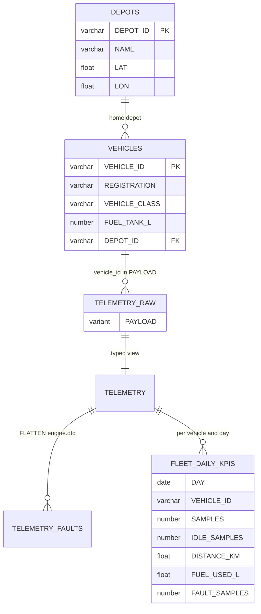

# Architecture

Design notes for the fleet telemetry service: the data model, why telemetry lands as semi-structured JSON, how trips and driving events are derived, and how the daily KPIs stay current.

## Data model



| Object | Kind | Purpose |
| --- | --- | --- |
| `TELEMETRY_RAW` | table | One row per ping, the device JSON in `PAYLOAD VARIANT` |
| `TELEMETRY_NDJSON`, `TELEMETRY_STAGE` | file format, internal stage | Backfill files, one JSON document per line |
| `DEPOTS`, `VEHICLES` | tables | Fleet registry (reference data, synced from fleet management in production) |
| `TELEMETRY` | view | Typed columns, UTC timestamps, one row per `message_id` |
| `TELEMETRY_FAULTS` | view | One row per active fault code per ping |
| `FLEET_DAILY_KPIS` | dynamic table | Distance, fuel, idling and faults per vehicle and UTC day |

All timestamps are UTC. Ping times are normalized with `CONVERT_TIMEZONE('UTC', ts::TIMESTAMP_TZ)` because device clocks may report any offset; trips and KPIs use UTC days.

## Semi-structured design

A ping looks like this (one line of an export file, or one element of a `POST /api/telemetry` batch):

```json
{"message_id":"TRK-101-20260907054800","vehicle_id":"TRK-101","ts":"2026-09-07T05:48:00Z",
 "gps":{"lat":51.889,"lon":4.431,"heading_deg":0},"speed_kmh":0,"odometer_km":309199.518,
 "fuel":{"level_pct":98.3,"used_l":75416.832},
 "engine":{"rpm":640,"coolant_c":32.8,"dtc":[{"code":"P0301","severity":"warning"}]}}
```

- **Land first, type later.** Firmware adds fields over time. The landing table stores the payload exactly as received, so a new field never breaks ingestion and history can be re-read when the view gains a column.
- **One shape for both paths.** The API validates a batch and inserts it with a single bound parameter, `PARSE_JSON(?)` flattened server-side, so a batch lands completely or not at all. The backfill loads the same JSON with `COPY INTO` into the same table.
- **Retries are expected.** Devices resend a batch when they miss the response. `message_id` identifies a ping; the `TELEMETRY` view keeps one row per `message_id` with `QUALIFY ROW_NUMBER() OVER (PARTITION BY VEHICLE_ID, MESSAGE_ID ...) = 1`. Including `VEHICLE_ID` in the partition lets a query's vehicle filter apply before the deduplication.
- **Nested arrays stay nested.** Active diagnostic trouble codes are an array inside `engine`. `TELEMETRY_FAULTS` unnests it with `LATERAL FLATTEN`, and `GET /api/vehicles/{id}/faults` aggregates occurrences, first and last seen per code.
- **Bad lines do not stop a load.** `COPY INTO ... ON_ERROR = CONTINUE` skips a corrupt line and reports it (`errors_seen`, `first_error`, `first_error_line`) per file; the backfill prints that report. Gateways export one file per vehicle per day, so a problem file is easy to trace back to its source.

## Trip segmentation

Devices report every 5 seconds while the ignition is on and stay silent when it is off, so trips are separated by gaps. The rule lives in `TripRules` and is applied in SQL:

```sql
WITH pings AS (
    SELECT TS, DATEDIFF('second', LAG(TS) OVER (ORDER BY TS), TS) AS GAP_S, ...
    FROM TELEMETRY WHERE VEHICLE_ID = :vehicleId AND TS >= :dayStart AND TS < :dayEnd
),
numbered AS (
    SELECT *, SUM(IFF(GAP_S IS NULL OR GAP_S > :maxGapS, 1, 0))
                  OVER (ORDER BY TS ROWS BETWEEN UNBOUNDED PRECEDING AND CURRENT ROW) AS TRIP_NO
    FROM pings
)
SELECT TRIP_NO, MIN(TS), MAX(TS), MAX(ODOMETER_KM) - MIN(ODOMETER_KM), ... FROM numbered GROUP BY TRIP_NO
```

- A gap of more than 10 minutes starts a new trip; exactly 10 minutes does not (a long traffic jam or a level crossing). Unit tests pin the boundary, and an integration test posts pings 600 and 601 seconds apart.
- Distance and fuel are odometer and fuel-counter differences, so lost pings do not distort them.
- Idle seconds in a trip are the time between consecutive stationary pings.
- **Harsh braking** compares each ping with the previous one (`LAG(SPEED_KMH)`): an average deceleration of at least 2.5 m/s² (about 0.25 g) is an event.
- **Idling** is a gaps-and-islands query: consecutive stationary pings form an island, and islands of 5 minutes or more are reported.

The API adds the derived figures in C# (`KpiMath`): fuel economy in L/100 km (none below 1 km), average speed including stops, idle share.

## Daily KPIs

`FLEET_DAILY_KPIS` is a dynamic table over the `TELEMETRY` view, one row per vehicle and day, with `TARGET_LAG = '15 minutes'`. Snowflake keeps it current; nothing in the application schedules refreshes. Two places refresh it on demand with `ALTER DYNAMIC TABLE FLEET_DAILY_KPIS REFRESH`: the backfill, so a dashboard shows a backfill as soon as it finishes, and the tests, so they need not wait for the lag.

`GET /api/fleet/daily` reads the vehicle-days for a range of at most 92 days and rolls them up in `FleetDailyKpis`. Fleet fuel economy is total fuel over total distance, not an average of vehicle ratios, so a van that moved 2 km does not weigh as much as a truck that drove 400.

## Configuration and sessions

- `SnowflakeOptions` binds the `Snowflake` section. `appsettings.json` holds the production shape; `appsettings.Development.json` changes only account, host, port and key path for the emulator. `SNOWFLAKE_*` environment variables override both.
- Authentication is key-pair only (`authenticator=snowflake_jwt`). `make up` writes a throwaway key to `.secrets/`; on an account, `ALTER USER FLEET_SVC SET RSA_PUBLIC_KEY = ...` registers its public half.
- `FleetDatabase` opens pooled sessions and sets a JSON `QUERY_TAG` with the application, the HTTP route and the request id, so a query in Snowflake's history leads back to its request.
- Every query uses bound parameters (`:name`, through Dapper). Every endpoint takes the request's `CancellationToken` down to the driver.
- Errors are RFC 9457 problem details: 404 for an unknown vehicle, 400 for malformed JSON, invalid pings (field errors keyed like `[3].speed_kmh`) and bad query parameters.
