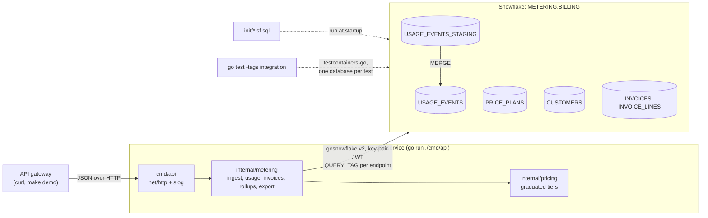
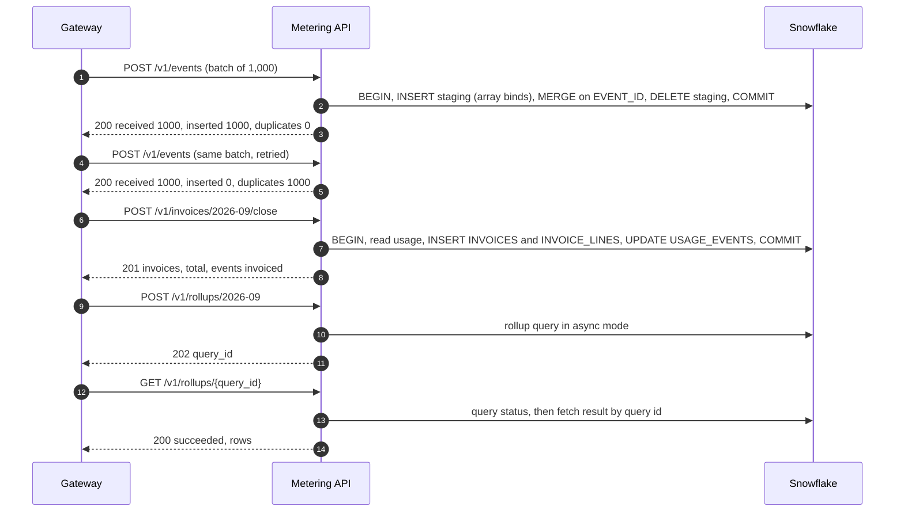

# Metering API

A Go service that meters API usage and bills it: customers on Free, Pro and Enterprise plans, idempotent usage ingestion, monthly invoices priced on graduated tiers, async rollups and a streamed CSV export, all on Snowflake through `database/sql` and gosnowflake. The Go app runs on your machine with `go run`, against a local Snowflake in Docker, the way you would develop it day to day.

## Architecture



## How it works

1. **Ingest** (`POST /v1/events`). The gateway posts batches of up to 1,000 usage reports. One `INSERT` with array binds lands the batch in a staging table, a `MERGE` keyed by `event_id` adds only the events not stored yet, and the staging rows are deleted, in one transaction. Retried batches change nothing.
2. **Usage** (`GET /v1/customers/{id}/usage?from=&to=`) aggregates a customer's calls per day.
3. **Invoice close** (`POST /v1/invoices/{month}/close`). One transaction rates every customer's uninvoiced usage against their plan's tiers (in Go, `internal/pricing`), inserts the invoices and their lines, and marks the usage invoiced. It commits all of it or none of it, and a month is closed only once.
4. **Rollup** (`POST /v1/rollups/{month}`) submits the monthly per-plan, per-day aggregation as an asynchronous Snowflake query and returns `202` with its query id. `GET /v1/rollups/{queryId}` reports the status and, once done, fetches the result by query id, from any instance of the service.
5. **Export** (`GET /v1/invoices/{month}/export.csv`) streams the invoice lines to the client as rows arrive.

Errors are RFC 9457 problem details (`application/problem+json`).



Design notes (data model, idempotency, transactions, async queries) are in [docs/architecture.md](docs/architecture.md).

## Prerequisites

- Docker with Compose v2
- Go 1.26 or newer (`go.mod` pins the 1.27.3 toolchain)
- `make`, `openssl` and `curl`
- A LocalStack auth token, exported as `LOCALSTACK_AUTH_TOKEN` or stored in `~/.localstack/default.env`

## Quickstart

```sh
make up      # throwaway key pair in .secrets/, start the local Snowflake, wait until it answers SQL
make seed    # 200 customers (120 Free, 60 Pro, 20 Enterprise), ~30,000 usage events over 3 months
make run     # the API on http://127.0.0.1:8080 (go run ./cmd/api)
make demo    # scripted walkthrough; starts the API itself if it is not running
make test    # unit tests, then integration tests on their own emulator
make down    # stop and remove the local Snowflake
```

If port 4566 is taken, pick another for every target: `SNOWFLAKE_PORT=14566 make up seed demo`.

With `make run` going:

```sh
curl -s -X POST localhost:8080/v1/events -d '{"events": [
  {"event_id": "evt_1", "customer_id": "cus_0007", "quantity": 1200, "occurred_at": "2026-09-30T10:00:00Z"}]}'
# {"received":1,"inserted":1,"duplicates":0}      (again: "inserted":0,"duplicates":1)
curl -s "localhost:8080/v1/customers/cus_0007/usage?from=2026-09-01&to=2026-10-01"
curl -s -X POST localhost:8080/v1/invoices/2026-09/close
# {"month":"2026-09","invoices":200,"total_cents":5828821,"events_invoiced":9700}
curl -s -X POST localhost:8080/v1/rollups/2026-09      # {"query_id":"...","status_url":"/v1/rollups/..."}
curl -s localhost:8080/v1/invoices/2026-09/export.csv | head -3
```

The seed covers the three months before the current one; use the last of them in these examples. The connection is configured only through environment variables (`.env.example` lists them all). Against a real account the same variables carry the account, user and key instead of the emulator defaults.

## Tests

`make test` runs both suites:

- **Unit tests** (`go test ./...`): tier pricing and rounding against hand-computed amounts, request validation, handler error responses, configuration and the data generator. No database.
- **Integration tests** (`go test -tags integration ./internal/metering/`): `TestMain` starts `localstack/snowflake-next` with testcontainers-go (`GenericContainer`, `LOCALSTACK_AUTH_TOKEN` passed through, readiness checked from the host over HTTPS on the mapped port) and provisions it with `init/01_platform.sf.sql`. Each test creates its own database from `init/02` and `init/03`, seeds a generated dataset through the API, runs in parallel with the others and drops its database at the end.

The integration tests check concrete values computed independently from the generated events and the published price list:

| Test | Asserts |
| --- | --- |
| `TestIngestIsIdempotent` | Re-posting every event inserts 0 rows and leaves counts, sums and per-customer usage unchanged; a batch with a repeated new event inserts it once |
| `TestCloseMonthInvoicesAtTierPrices` | Every invoice total equals tier pricing by hand, including a Pro customer with no usage (the $49 fee); only the closed month is invoiced; a second close is `409` |
| `TestCloseMonthIsAtomic` | A failure injected after the invoices are written leaves no invoices, no lines and no invoiced usage; the retried close succeeds |
| `TestRollupRunsAsync` | The rollup returns `202`, reaches `succeeded` within a bounded poll, and returns exactly the expected per-plan, per-day rows |
| `TestInvoiceExportCSV` | Row count and SHA-256 of the export match a CSV built from the dataset; `404` before the month is closed |
| `TestErrorPaths` | Unknown customer `404`, malformed JSON `400`, invalid events `422`, unknown customer in a batch `422` with nothing stored, unknown rollup `404` |

To run the integration tests against Snowflake, set `SNOWFLAKE_ACCOUNT`, `SNOWFLAKE_USER`, `SNOWFLAKE_PRIVATE_KEY_PATH`, `SNOWFLAKE_ROLE` (with `CREATE DATABASE`) and `SNOWFLAKE_WAREHOUSE` (X-Small is plenty), then run `make test-cloud`. Each test creates and drops a `METERING_IT_<random>` database; this consumes credits.

## Project structure

```
metering-api/
  Makefile, docker-compose.yml, .env.example, go.mod, go.sum
  init/
    01_platform.sf.sql      warehouse, role, database, service user
    02_schema.sf.sql        tables (database-relative)
    03_price_plans.sf.sql   Free, Pro and Enterprise tiers
  cmd/
    api/                    HTTP server, graceful shutdown
    seed/                   loads the synthetic dataset (idempotent)
    demo/                   the make demo walkthrough
  internal/
    config/                 environment settings, key-pair auth, connection pool
    pricing/                graduated tier rating
    metering/               service, handlers, problem details, integration tests
    seed/                   deterministic data generator
  scripts/                  wait-for-emulator.sh, demo.sh
  docs/architecture.md      data model and design notes
```

## Learn more

- [Go Snowflake driver](https://docs.snowflake.com/en/developer-guide/golang/go-driver) and [gosnowflake on pkg.go.dev](https://pkg.go.dev/github.com/snowflakedb/gosnowflake/v2)
- [Key-pair authentication](https://docs.snowflake.com/en/user-guide/key-pair-auth)
- [`MERGE`](https://docs.snowflake.com/en/sql-reference/sql/merge) and [transactions](https://docs.snowflake.com/en/sql-reference/transactions)
- [Asynchronous queries in gosnowflake](https://pkg.go.dev/github.com/snowflakedb/gosnowflake/v2#hdr-Asynchronous_Queries), [persisted query results](https://docs.snowflake.com/en/user-guide/querying-persisted-results) and [`QUERY_TAG`](https://docs.snowflake.com/en/sql-reference/parameters#query-tag)
- [testcontainers-go](https://golang.testcontainers.org/) and [RFC 9457 problem details](https://www.rfc-editor.org/rfc/rfc9457)
