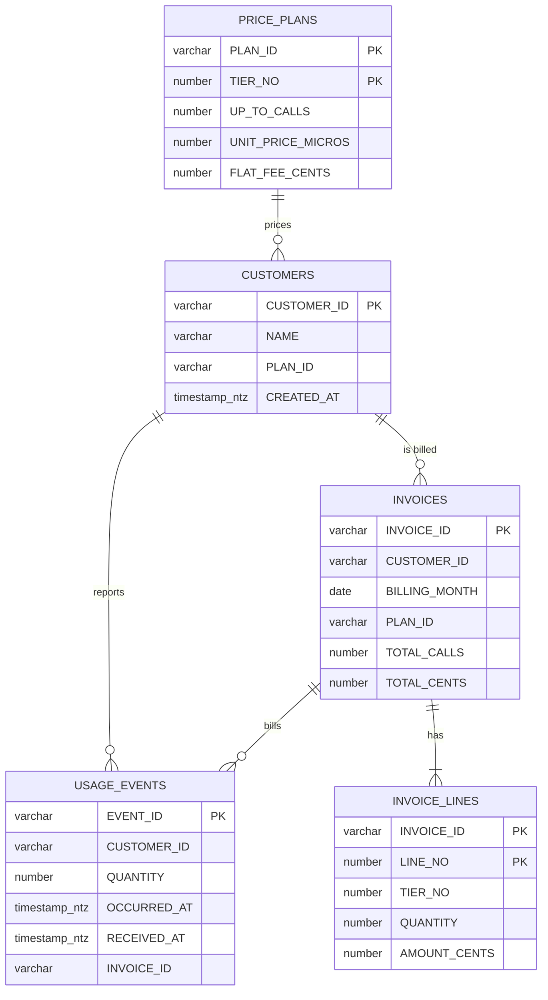

# Metering API: design notes

How the [Metering API](../README.md) stores usage, prices it and talks to Snowflake.

## Data model

- A usage event is one report from the API gateway: `QUANTITY` calls by one customer in one reporting window. `EVENT_ID` is the gateway's idempotency key.
- Money is integer throughout: unit prices in micro-dollars per call, amounts in cents. Nothing is ever a float.
- `USAGE_EVENTS_STAGING` (transient, not shown) holds an ingest batch for the length of one transaction.
- Snowflake records primary keys but does not enforce them; the write paths below keep the keys unique.

## Pricing

Plans are graduated tiers, one `PRICE_PLANS` row per tier. Calls fill the tiers from the bottom: each tier bills the calls between the previous tier's limit and its own at its unit price, plus its flat fee once usage reaches it. Tier 1 is always reached, so its flat fee is the monthly fee.

| Plan | Tier 1 | Tier 2 | Tier 3 |
| --- | --- | --- | --- |
| FREE | first 10,000 calls free | $2.00 per 1,000 | |
| PRO | $49, includes 100,000 calls | $0.80 per 1,000 up to 1M | $0.50 per 1,000 |
| ENTERPRISE | $499, includes 1M calls | $0.40 per 1,000 up to 10M | $0.25 per 1,000 |

Example: a Pro customer with 250,000 calls pays $49 + 150,000 x $0.80 / 1,000 = $169.00. Each line is rounded half up to the cent. Rating runs in Go (`internal/pricing`), so it is unit-tested without a database; the tiers themselves are data.

## Idempotent ingestion

`POST /v1/events` accepts up to 1,000 events and runs one transaction:

1. `INSERT INTO USAGE_EVENTS_STAGING ... VALUES (?, ?, ?, ?, ?)` with one array bind per column (`gosnowflake.Array`), tagged with a fresh `BATCH_ID`. The whole batch is one round trip.
2. A `LEFT JOIN` against `CUSTOMERS` finds unknown customer ids; if there are any, the transaction rolls back and the API answers `422` with the ids.
3. `MERGE INTO USAGE_EVENTS ... ON t.EVENT_ID = s.EVENT_ID WHEN NOT MATCHED THEN INSERT`, over the batch deduplicated with `QUALIFY ROW_NUMBER() OVER (PARTITION BY EVENT_ID ...) = 1`. The `MERGE`'s row count is the number of new events.
4. `DELETE` of the batch's staging rows, then `COMMIT`.

Snowflake serializes concurrent `MERGE` statements on a table, so two gateways retrying the same event at once still store it once. The 1,000-event cap keeps each array bind well inside a single request.

## Transactional invoice close

`POST /v1/invoices/{month}/close` refuses a month that has not ended (`409`) and runs one `database/sql` transaction:

1. If `INVOICES` already has rows for the month, roll back with `409`: invoices are issued once.
2. Read `PRICE_PLANS`, and every customer's uninvoiced calls in the month (`LEFT JOIN`, so customers without usage are billed their monthly fee).
3. Rate each customer in Go, then insert all invoices and all invoice lines with two array-bound `INSERT`s.
4. `UPDATE USAGE_EVENTS ... FROM INVOICES` sets `INVOICE_ID` on the month's events.
5. `COMMIT`.

Any error rolls everything back, so a month is either fully invoiced or untouched and can simply be closed again. The integration suite proves this by failing the transaction between steps 3 and 4. Invoice ids are deterministic (`inv_202609_cus_0007`), which keeps the export stable and makes retries easy to reason about.

## Async rollups

The monthly rollup (calls, events and active customers per plan and day) is a query a dashboard asks for and polls, rather than a request that holds a connection open:

- `POST /v1/rollups/{month}` runs the query with `gosnowflake.WithAsyncMode` and returns `202` with the Snowflake query id as soon as Snowflake accepts it. The request's context is detached (`context.WithoutCancel` plus a timeout) so the query is not canceled when the response is sent.
- `GET /v1/rollups/{queryId}` calls `GetQueryStatus` on a pooled connection: running, failed, unknown (`404`) or succeeded. On success it reads the rows with `WithFetchResultByID`.

Results are kept by Snowflake, not by the service, so any replica can answer the poll, and a restart loses nothing.

## Streaming export

`GET /v1/invoices/{month}/export.csv` scans rows from `database/sql` and writes them straight to a `csv.Writer` on the response, flushing every 500 rows. Memory stays flat whatever the month's size. If a read fails after the first byte has been sent, the handler aborts the connection so the client sees a broken transfer rather than a short file.

## Connection and configuration

- All settings come from the environment (`internal/config`), with `TEST_TARGET` choosing emulator or account defaults. The production shape is the same: only `SNOWFLAKE_ACCOUNT`, `SNOWFLAKE_HOST` and the key change.
- Authentication is key-pair only (`SNOWFLAKE_JWT`) with a PKCS#8 key; `make up` generates a throwaway pair in `.secrets/`. On a real account, register the public key with `ALTER USER METERING_SVC SET RSA_PUBLIC_KEY = '...'`.
- One `*sql.DB` pool per process. Every route sets a `QUERY_TAG` through the context (`metering-api:invoices.close`, `metering-api:events.ingest`, ...), so `QUERY_HISTORY` shows which endpoint ran each statement.
- The API shuts down gracefully on `SIGINT`/`SIGTERM`: it stops accepting connections and waits for in-flight requests.

## Test isolation

`TestMain` provisions the account once (`init/01_platform.sf.sql`). Each test then creates a `METERING_IT_<random>` database, hands it to the service role, applies `init/02_schema.sf.sql` and `init/03_price_plans.sf.sql` to it, starts the API on `httptest` and drops the database in `t.Cleanup`. Tests share nothing, so they run with `t.Parallel()`, and the same code runs unchanged against a real account with `TEST_TARGET=SNOWFLAKE_CLOUD`.
