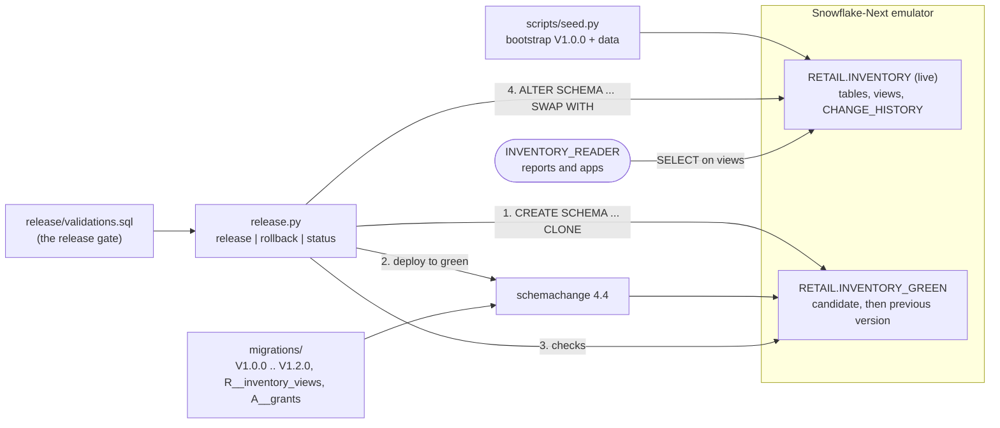
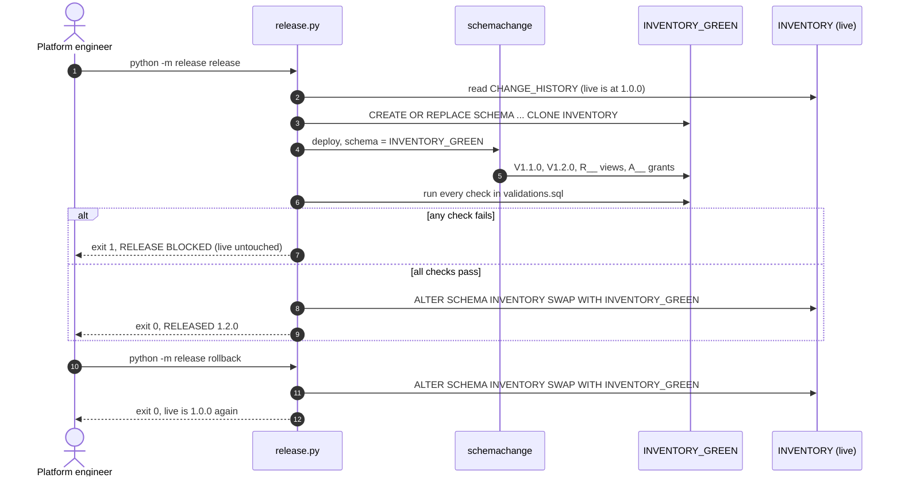

# Migrate and Swap

Zero-downtime schema releases for a retail inventory service: migrate a zero-copy clone with schemachange, validate it, swap it in atomically, and roll back with one more swap. Built for data platform engineers who want to rehearse releases against production-shaped data on their laptop or in CI, before anything reaches a live warehouse.

## Architecture



Readers only ever see `RETAIL.INVENTORY`. A release builds the next version beside it in `RETAIL.INVENTORY_GREEN`, from a zero-copy clone of live, so a migration meets production data without touching production. The swap is a single metadata operation, and the old version stays intact in green, which is what makes rollback one more swap. Design notes are in [docs/architecture.md](docs/architecture.md).

## How it works

1. **Clone.** `CREATE OR REPLACE SCHEMA INVENTORY_GREEN CLONE INVENTORY` copies metadata, not data, so it takes seconds at any size.
2. **Migrate.** schemachange runs against green. The change history lives inside the schema and is cloned with it, so only the scripts live does not have are applied. A failing script exits 2.
3. **Validate.** Every check in [`release/validations.sql`](release/validations.sql) runs against green: row-count parity, no negative stock, no orphan ledger rows, receipts match purchase orders, no view dropped, every view selectable. One failure exits 1 and live is untouched.
4. **Swap.** `ALTER SCHEMA INVENTORY SWAP WITH INVENTORY_GREEN` exchanges both schemas in one statement.
5. **Roll back.** `rollback` swaps again, but only when green's history is a strict subset of live's, so it can never roll forward.

`make demo` shows the gate at work: [`demos/V1.3.0__bad_negative_stock.sql`](demos/V1.3.0__bad_negative_stock.sql) looks harmless on staging data but drives nine backordered rows negative on production data. The gate catches it on the clone and the swap never happens. The demo then releases the good migrations, rolls back, and runs two recovery drills: `UNDROP TABLE` for a dropped table, and a clone `BEFORE(STATEMENT => ...)` plus `INSERT OVERWRITE` to undo a bad `UPDATE` in place.



## Prerequisites

- Docker with Compose v2
- [`uv`](https://docs.astral.sh/uv/) 0.5 or newer (installs Python 3.12 if needed)
- `openssl` and `curl`
- A LocalStack auth token in `LOCALSTACK_AUTH_TOKEN` or `~/.localstack/default.env`

## Quickstart

```sh
cd migrate-and-swap
make up      # generate a dev key pair, start the emulator, install the Python env
make seed    # (re)create RETAIL with live INVENTORY at V1.0.0 and the data set
make demo    # blocked release, good release, rollback, two recovery drills
make test    # the full suite
make down    # stop the emulator and remove its volumes
```

To drive releases by hand after `make seed`, use `make release`, `make status` and `make rollback`. If port 4566 is taken, set another one: `SNOWFLAKE_PORT=14566 make up test down`.

## Tests

Every test seeds its own `MAS_TEST_<random>` database with the real baseline migration and drops it afterwards, so the suite runs in parallel. Expected values come from the generated data set and the rules written in the migrations. The suite covers:

- a release of V1.1.0 and V1.2.0 that swaps in, with every backfilled value and view row checked;
- the bad migration blocked by the gate, with live's row counts, history, columns and views unchanged;
- rollback to the exact previous snapshot, and a refused second rollback;
- each gate check failing on the defect it exists for;
- readers keeping `USAGE` and `SELECT` across the swap;
- the `UNDROP` and point-in-time restore runbooks, and their error paths.

`make test-cloud` runs the same suite against a real Snowflake account (billable). Set `SNOWFLAKE_ACCOUNT`, `SNOWFLAKE_USER`, `SNOWFLAKE_WAREHOUSE` and `SNOWFLAKE_PRIVATE_KEY_PATH` (an unencrypted PKCS#8 key), and optionally `SNOWFLAKE_ROLE` (default `ACCOUNTADMIN`). Use a non-production account.

## Project structure

```
migrate-and-swap/
  migrations/              V1.0.0 .. V1.2.0, R__inventory_views.sql, A__grants.sql
  demos/                   the bad migration the gate must stop
  release/                 release tool: clone, migrate, validate, swap, rollback, recovery
    validations.sql        the release gate
  scripts/                 seed.py, wait-for-emulator.sh
  init/                    emulator init hook: warehouse, service user, reader role
  tests/                   pytest suite
  docs/architecture.md     design notes
```

## Learn more

- [Cloning considerations](https://docs.snowflake.com/en/user-guide/object-clone) and [`CREATE <object> ... CLONE`](https://docs.snowflake.com/en/sql-reference/sql/create-clone)
- [`ALTER SCHEMA ... SWAP WITH`](https://docs.snowflake.com/en/sql-reference/sql/alter-schema)
- [Understanding and using Time Travel](https://docs.snowflake.com/en/user-guide/data-time-travel) and [`UNDROP TABLE`](https://docs.snowflake.com/en/sql-reference/sql/undrop-table)
- [schemachange](https://github.com/Snowflake-Labs/schemachange)
