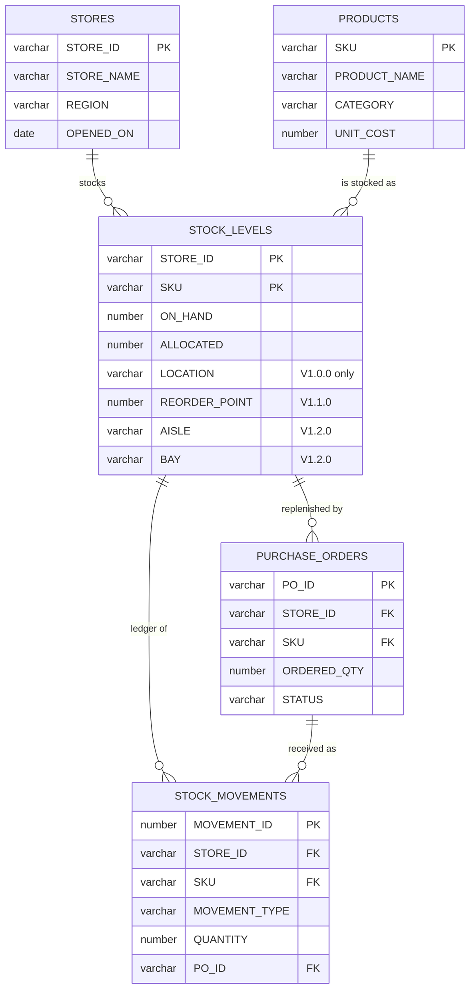
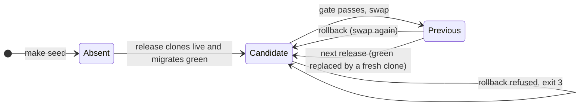

# Architecture: Migrate and Swap

Design notes for the release tool: the data model, the main design decisions, and what a swap does not cover. The README covers how to run it.

## Data model

`STOCK_LEVELS` is the current snapshot per store and SKU; `STOCK_MOVEMENTS` is the signed ledger. `ALLOCATED` may exceed `ON_HAND` when a store sells into backorder. Keys are informational in Snowflake, so the release gate is what checks referential integrity. The data set ([`release/dataset.py`](../release/dataset.py)) is generated from a fixed seed and plants nine backordered rows and some unnormalised shelf addresses for the migrations to meet.

## Design decisions

**Migrate a clone, not live.** schemachange has no rollback and DDL commits implicitly, so a migration that fails halfway, or succeeds but is wrong, would leave live in an untested state. A zero-copy clone gives the migration real data at no risk, a gate before exposure, and an instant rollback target.

**The change history lives inside the schema.** `<schema>.CHANGE_HISTORY` is cloned and swapped with the schema it describes, so each side always knows its own version. `rollback` swaps only when green's history is a strict subset of live's; otherwise it would be a roll-forward and is refused.

**Swap, then keep the previous version.** `ALTER SCHEMA ... SWAP WITH` renames both schemas in one metadata operation, so there is no moment when `RETAIL.INVENTORY` points at nothing.

The diagram follows what the green schema holds. *Previous* is the only state in which `rollback` swaps.

**Views are unqualified and owned by the repeatable script.** View bodies name tables without a schema, so the same view reads green's tables in green and live's tables after the swap. Views are dropped before structural changes and rebuilt by `R__inventory_views.sql`, so every release leaves them consistent.

**Grants are an always-script.** `A__grants.sql` grants `USAGE` on the schema and `SELECT` on all its views to `INVENTORY_READER` on every deploy, so the schema that is swapped in always carries the reader grants. The init hook creates the reader role up front, so it exists before the first deploy.

**The gate is SQL, in one file.** Each check in [`release/validations.sql`](../release/validations.sql) is a query whose rows are violations. Checks guard invariants every release must keep (row counts, physical stock, referential integrity, view availability). `view_selectable` counts each whole view, so the engine expands and executes it end to end.

## What a swap does not do

- **It does not merge writes.** Writes to live between the clone and the swap would be lost, so `row_count_parity` fails the release if any count moved. A rollback is point-in-time; `rollback` prints a note per table whose row counts differ.
- **It does not recover deleted data.** That is time travel's job ([`release/recovery.py`](../release/recovery.py)): `UNDROP TABLE` for a dropped table, and for a bad statement a clone `BEFORE(STATEMENT => ...)` restored with `INSERT OVERWRITE`, which keeps the table's identity, grants and dependent views. Both work inside the retention period.

## Alternatives considered

| Alternative | Why not here |
| --- | --- |
| Migrate live in place with down-migrations | DDL autocommits, and down-migrations cannot restore data a destructive step dropped |
| Clone and swap the whole database | Right when a release spans schemas; a schema is the smallest unit that holds this service |
| Rename instead of swap | Two statements, with a window in which `INVENTORY` does not exist |
| A metadata database for the change history | The history would no longer move with the schema on a swap or a rollback |
