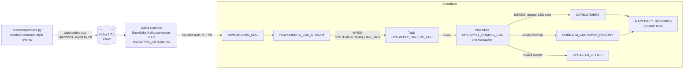
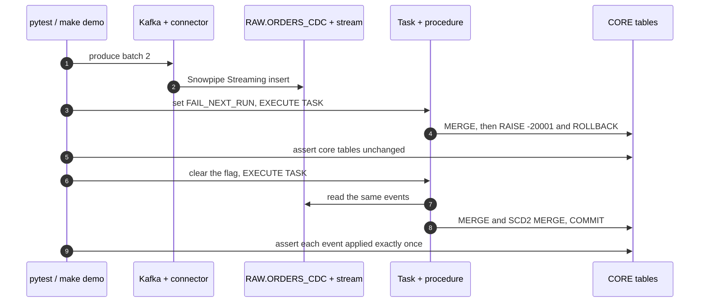

# Order-to-Cash CDC

A near-real-time order pipeline from Kafka to marts, built from Snowflake streams, tasks, SQL Scripting procedures and dynamic tables. It is for data engineers who own a CDC pipeline and want to test its failure paths (a run that dies after its MERGE, replayed and late events) deterministically on a laptop.

## Architecture



A seeded producer publishes Debezium-style change events for TPC-H `orders` and `customer` to Kafka. The Snowflake Kafka connector lands them with Snowpipe Streaming, and a stream-driven task calls one procedure that applies each batch to a current-state table, an SCD2 history and a dead-letter table. A dynamic table serves daily bookings by market segment.

## How it works

1. **Change events.** `producer/produce.py` emits a customer snapshot, then inserts, updates and deletes, one envelope per commit with a strictly increasing `source.lsn`. Delivery adds duplicates, late events and three invalid records.
2. **Landing.** The connector writes each record into `RAW.ORDERS_CDC` as `RECORD_METADATA` and `RECORD_CONTENT` VARIANT columns. Its private key is read through Kafka Connect's `FileConfigProvider`, never stored in the connector config.
3. **Apply.** In one transaction, `OPS.APPLY_ORDERS_CDC()` parses the stream, dead-letters invalid events, de-duplicates with `QUALIFY ROW_NUMBER()`, MERGEs `CORE.ORDERS` (soft delete) and SCD2-MERGEs `CORE.DIM_CUSTOMER_HISTORY`. Every write is idempotent, so replays and retries never double-apply.
4. **Failure.** Setting `OPS.PIPELINE_CONTROL.FAIL_NEXT_RUN` makes the procedure raise after its MERGEs. The handler rolls back and re-raises, so the task run is `FAILED` in `TASK_HISTORY()` and the next run applies the same events exactly once.
5. **Serve.** `MART.DAILY_BOOKINGS` aggregates live orders by order date and each customer's current segment.



## Prerequisites

- Docker with Compose v2 (about 2 GB of free memory)
- [`uv`](https://docs.astral.sh/uv/) (installs Python 3.12 if needed)
- `openssl`, `make`, `curl`
- A LocalStack auth token, exported as `LOCALSTACK_AUTH_TOKEN` or stored in `~/.localstack/default.env`

## Quickstart

```sh
make up      # dev key pair, Snowflake + Kafka + Connect, sink connector registered
make seed    # push the seeded events through the O2C database
make demo    # forced failure, rollback, exactly-once retry (database O2C_DEMO)
make test    # run the test suite
make down    # stop and remove everything
```

Host ports default to `4566` (Snowflake), `19092` (Kafka) and `18083` (Kafka Connect REST); override them with `SNOWFLAKE_PORT`, `KAFKA_PORT` and `CONNECT_PORT`. After `make seed`, connect any Snowflake client to host `snowflake.localhost.localstack.cloud` and try:

```sql
SELECT * FROM O2C.CORE.DIM_CUSTOMER_HISTORY WHERE C_CUSTKEY = 1 ORDER BY VALID_FROM;
SELECT * FROM TABLE(O2C.INFORMATION_SCHEMA.TASK_HISTORY(TASK_NAME => 'APPLY_ORDERS_CDC'))
WHERE DATABASE_NAME = 'O2C';
```

## Tests

Each scenario runs in its own database, topic and sink connector, and every expected value is computed independently from the producer's events in `tests/model.py`. The suite covers:

- every Kafka record lands exactly once through the Snowflake Kafka connector;
- `CORE.ORDERS` holds the newest version of every order, with soft deletes;
- the SCD2 history has one version per change, and a customer delete closes the open version;
- duplicate, late and replayed events never create rows or regress state;
- invalid events land in `OPS.DEAD_LETTER` with the right reason;
- `MART.DAILY_BOOKINGS` matches independently computed totals;
- a MERGE without de-duplication fails with `100090 Duplicate row detected during DML action`;
- a forced failure rolls back completely and the retry applies each event exactly once.

To run the same suite against a Snowflake account, start Kafka and Connect with `make up`, set `SNOWFLAKE_ACCOUNT`, `SNOWFLAKE_USER`, `SNOWFLAKE_ROLE` (with `CREATE DATABASE`), `SNOWFLAKE_WAREHOUSE` and `SNOWFLAKE_PRIVATE_KEY_PATH` (a key registered for that user), then run `make test-cloud`. One-time account setup is in [docs/architecture.md](docs/architecture.md#running-on-a-snowflake-account).

## Project structure

```
order-to-cash-cdc/
  Makefile               up, seed, demo, test, down, test-cloud, logs
  docker-compose.yml     Snowflake, Kafka, Kafka Connect
  connect/               Connect image, worker config, sink connector config
  init/                  landing zone, core tables, procedure, task, dynamic table
  producer/produce.py    seeded change generator and Kafka publisher
  pipeline/              settings, deploy, Connect client, harness, seed and demo
  tests/                 end-to-end, transaction and model tests
  scripts/               readiness check
  docs/architecture.md   design notes
```

## Learn more

- [Snowflake Kafka connector with Snowpipe Streaming](https://docs.snowflake.com/en/user-guide/data-load-snowpipe-streaming-kafka)
- [Streams](https://docs.snowflake.com/en/user-guide/streams-intro) and [tasks](https://docs.snowflake.com/en/user-guide/tasks-intro)
- [Transactions in Snowflake Scripting](https://docs.snowflake.com/en/developer-guide/snowflake-scripting/transactions)
- [`MERGE`](https://docs.snowflake.com/en/sql-reference/sql/merge) and [dynamic tables](https://docs.snowflake.com/en/user-guide/dynamic-tables-intro)
- [Debezium PostgreSQL connector event format](https://debezium.io/documentation/reference/stable/connectors/postgresql.html#postgresql-events)
