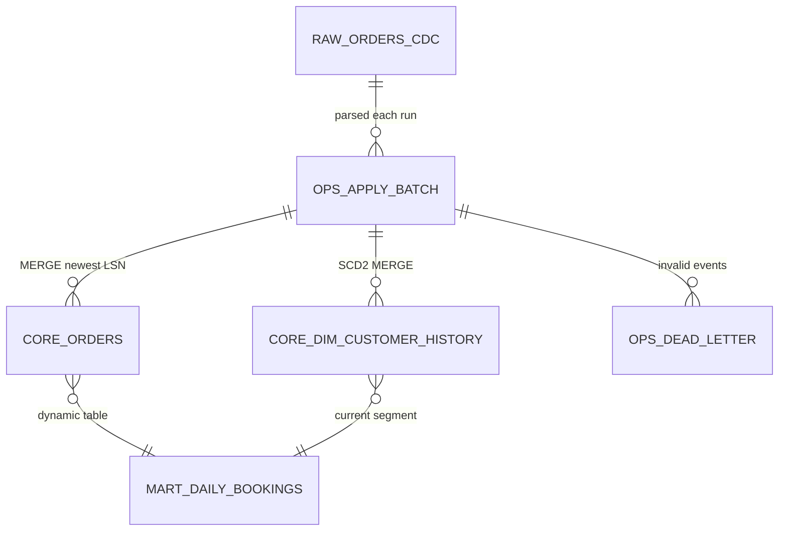
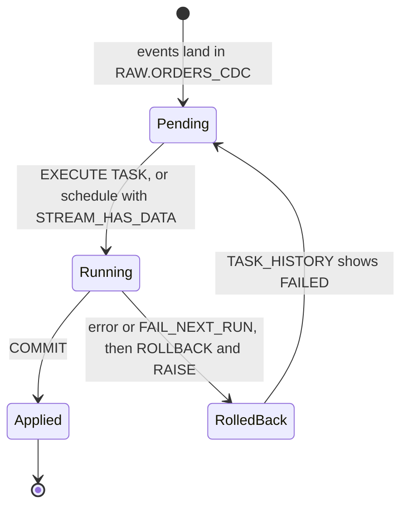

# Architecture notes

Design notes for the Order-to-Cash CDC sample. Start with the [README](../README.md) for the overview.

## Event contract

Each Kafka record value is a Debezium change envelope (PostgreSQL connector shape, `decimal.handling.mode=string`, dates as days since the epoch). The key is the primary key as JSON, for example `{"o_orderkey": 17}`.

```json
{
  "before": null,
  "after": {"o_orderkey": 17, "o_custkey": 4, "o_orderstatus": "O", "o_totalprice": "182315.40",
            "o_orderdate": 20729, "o_orderpriority": "2-HIGH", "o_clerk": "Clerk#000000412"},
  "source": {"connector": "postgresql", "db": "tpch", "schema": "public", "table": "orders",
             "lsn": 24001250, "ts_ms": 1790845200000},
  "op": "c",
  "ts_ms": 1790845200250
}
```

- `op`: `r` (snapshot read), `c`, `u`, `d`. A delete carries the row in `before`.
- `source.lsn`: strictly increasing per source database, so it orders all changes to a key regardless of Kafka partition or arrival order. It is the pipeline's version number.
- `source.ts_ms`: commit time in the source; it becomes `SOURCE_TS` and the SCD2 validity boundaries.

## Data model



| Object | Kind | Notes |
| --- | --- | --- |
| `RAW.ORDERS_CDC` | table | Connector-managed landing zone, append only |
| `RAW.ORDERS_CDC_STREAM` | standard stream | Unprocessed rows of the landing table |
| `OPS.APPLY_BATCH` | transient table | Parsed events of the latest run, kept for debugging |
| `CORE.ORDERS` | table | Current state per order, soft delete |
| `CORE.DIM_CUSTOMER_HISTORY` | table | SCD2, validity `[VALID_FROM, VALID_TO)` |
| `OPS.DEAD_LETTER` | table | Rejected events with the reason, keyed by topic, partition and offset |
| `OPS.PIPELINE_CONTROL` | table | `FAIL_NEXT_RUN` switch |
| `OPS.APPLY_ORDERS_CDC` | procedure and task | The whole apply in one transaction; the task is created suspended and triggered with `EXECUTE TASK` |
| `MART.DAILY_BOOKINGS` | dynamic table | Live orders by order date and current segment |

## The apply procedure

`OPS.APPLY_ORDERS_CDC()` runs inside `BEGIN TRANSACTION ... COMMIT`:

1. Rewrite `OPS.APPLY_BATCH` from `RAW.ORDERS_CDC_STREAM`, setting `REJECT_REASON` for an unknown table or op, or a missing LSN, timestamp or key.
2. `MERGE INTO OPS.DEAD_LETTER` for rejected rows, inserting only records not yet dead-lettered.
3. `MERGE INTO CORE.ORDERS` from the newest event per key (`QUALIFY ROW_NUMBER()`), updating only when the event's LSN is newer than the stored one. A delete sets `IS_DELETED`.
4. SCD2 `MERGE INTO CORE.DIM_CUSTOMER_HISTORY`: customer events newer than the newest applied version become versions with `VALID_TO = LEAD(SOURCE_TS)`, and the open version is closed. A delete closes the open version and opens none.
5. If `OPS.PIPELINE_CONTROL.FAIL_NEXT_RUN` is `TRUE`, raise a user exception (-20001); otherwise `COMMIT`.

The exception handler runs `ROLLBACK; RAISE;`: nothing of the run persists, and re-raising makes the task run `FAILED` in `TASK_HISTORY()`, where alerting can see it.

Every write is idempotent, so replays and retries never double-apply:

| Situation | What prevents a wrong result |
| --- | --- |
| Duplicate delivery in one batch | `QUALIFY` keeps one row per key (orders) or per key and LSN (customers) |
| Duplicate, replayed or late delivery | LSN-guarded MERGEs: an event no newer than the applied state changes nothing |
| Delete followed by a late create | The soft-deleted row keeps the delete's LSN, so the older create loses |
| Failed run | One transaction, rolled back; the next run applies the same events |
| Invalid record seen again | Dead-letter MERGE keyed by topic, partition and offset |



## Test isolation

Every scenario gets its own database (`O2C_T_<id>`), deployed from the part of each `init/*.sf.sql` file below its `-- @deploy:` marker, plus its own topic and sink connector from `connect/snowflake-sink.json`. All three are removed when the scenario ends, so tests run against exactly the DDL and connector configuration that `make up` deploys and never share data. `make demo` uses the same mechanism with the fixed database `O2C_DEMO`. Every wait polls a condition with a timeout; nothing waits on the task's schedule.

## Running on a Snowflake account

`TEST_TARGET=SNOWFLAKE_CLOUD` (set by `make test-cloud`) points the tests and the sink's `snowflake.url.name` at `SNOWFLAKE_ACCOUNT`; Kafka and Connect still run locally. Before the first run:

1. Run the part of `init/01_landing.sf.sql` above the `@deploy` marker (warehouse, `O2C_INGEST` role, `SAMPLE_SVC` user), or point `SNOWFLAKE_WAREHOUSE`, `SNOWFLAKE_USER` and `O2C_CONNECTOR_ROLE` at existing objects.
2. Register the public key: `ALTER USER SAMPLE_SVC SET RSA_PUBLIC_KEY = '...'` with the body of `.secrets/rsa_key.pub`, or set `SNOWFLAKE_PRIVATE_KEY_PATH` to an already registered key and delete `.secrets/connector.properties` so `make up` regenerates it.
3. `make test-cloud`. Each scenario creates and drops its own database, so the role needs `CREATE DATABASE`.
