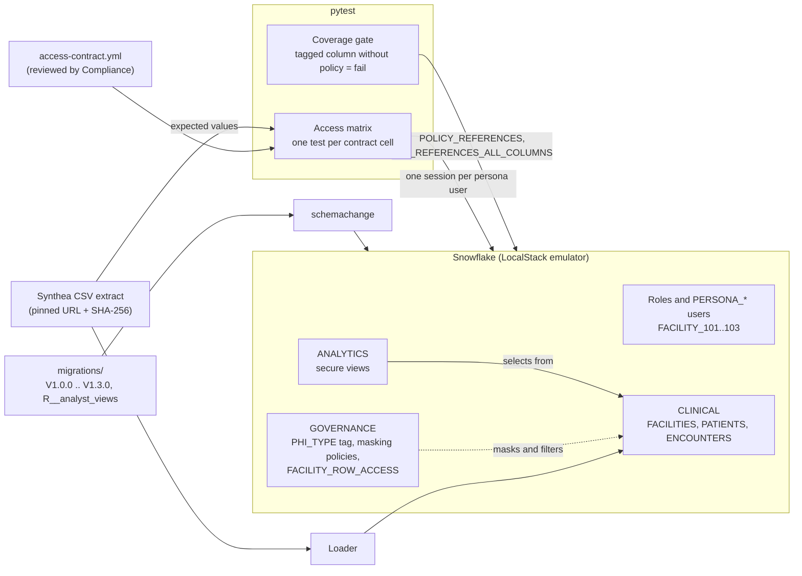
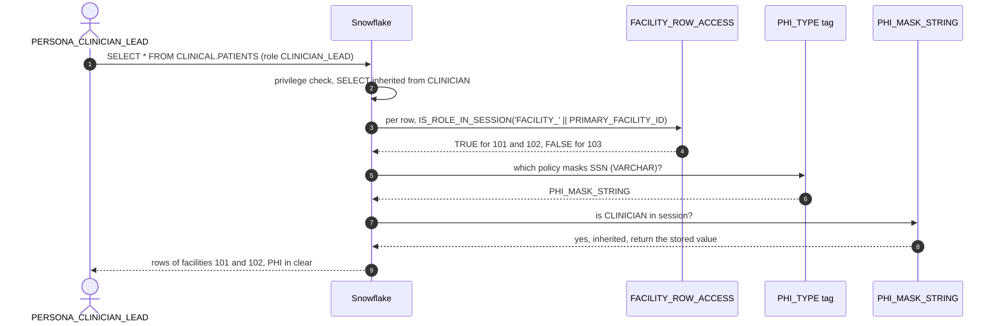

# PHI Guardrails

Governance as code for a healthcare dataset: every role-by-column access rule is a test generated from a reviewed contract file, and a policy-coverage gate fails the build when a PHI column carries a tag but no masking policy. It is for platform and governance engineers who want RBAC, masking and row access policies tested on every pull request, locally, before they reach production.

## Architecture



Everything that grants or hides data is deployed by schemachange from `migrations/`; the init hook only creates a warehouse and the deploy user. Each test session deploys the same migrations into its own `PHI_TEST_<random>` database, loads the data and drops the database afterwards, so the suite tests the migrations rather than a hand-built fixture. The data is Synthea's fully synthetic 1K-patient sample, downloaded at run time and verified by SHA-256. Design notes: [docs/architecture.md](docs/architecture.md).

## How it works

1. `V1.0.0` creates five functional roles (`CLINICIAN`, `CLINICIAN_LEAD` which inherits it, `ANALYST`, `AUDITOR`, `DATA_ENGINEER`), one key-pair user per persona, the schemas and the tables.
2. `V1.1.0` creates the `PHI_TYPE` tag with `ALLOWED_VALUES` and attaches one masking policy per data type to it, so classifying a column is all it takes to mask it.
3. `V1.2.0` adds `FACILITY_ROW_ACCESS`: a row is visible when the session holds the row's `FACILITY_<id>` role, or is an auditor or analyst.
4. `V1.3.0` adds `PATIENTS.EMAIL` with nothing but a tag, and `R__analyst_views.sql` publishes the secure views analysts read.
5. The access matrix connects as each persona's own user, reads every object, and compares each row with values computed from the Synthea source rows and the contract, never from the policies.
6. The coverage gate lists tagged columns and their effective masking policies, and exits 1 if any has none.

`make demo` runs the matrix, shows `EMAIL` masked by its tag alone, then applies [`demos/broken-current-role-policy.sql`](demos/broken-current-role-policy.sql): a one-line "simplification" that uses `CURRENT_ROLE() = 'CLINICIAN'` instead of `IS_ROLE_IN_SESSION('CLINICIAN')`. The matrix fails exactly the 10 text-PHI cells of `CLINICIAN_LEAD`, and the demo restores the policy.



## Prerequisites

- Docker with Compose v2
- [`uv`](https://docs.astral.sh/uv/) 0.5 or newer (it installs Python 3.12 if needed)
- `openssl`, for the throwaway local key pair
- A LocalStack auth token in `LOCALSTACK_AUTH_TOKEN` or `~/.localstack/default.env`
- Internet access on first run, for the emulator image and the 9 MB Synthea archive (cached in `.cache/`)

## Quickstart

```sh
cd phi-guardrails
make up      # generate a key pair, start the emulator, wait until it answers
make seed    # deploy the migrations into PHI and load the Synthea extract
make demo    # access matrix, the tag-only EMAIL column, the broken-policy drill
make test    # full suite in its own PHI_TEST_<random> database
make down    # stop the emulator and remove its volumes
```

Set `SNOWFLAKE_PORT` (for example `SNOWFLAKE_PORT=14566 make up test down`) if host port 4566 is taken. `make gate` runs the coverage gate against `PHI`.

## Tests

`make test` deploys, loads, runs everything and drops its database. The suite covers:

- **Access matrix**: one test per cell of [`access-contract.yml`](access-contract.yml) (174 cells): each persona sees exactly the rows (`all`, `facility`, `none`, `denied`) and the `clear` or `masked` values the contract states.
- **Regression detection**: with the broken policy applied, exactly the 10 clear text-PHI cells of `CLINICIAN_LEAD` fail.
- **Tag-only masking**: `EMAIL`'s only masking policy is the one its tag carries.
- **Coverage gate**: passes on the deployed database (14 tagged columns), and fails, naming exactly those columns, on a scratch table with tagged `NUMBER` and `TIMESTAMP_TZ` columns.
- **Classification and error paths**: tags match the contract, every clinical column is classified, an unknown PHI type is rejected (`391826`), the tag accepts no second `VARCHAR` policy (`391837`), and an attached policy cannot be replaced (`003531`).
- **Deployment**: schemachange records every migration, and a second deploy applies nothing.

To run the same suite against a real account, set `SNOWFLAKE_ACCOUNT`, `SNOWFLAKE_USER`, `SNOWFLAKE_WAREHOUSE` and `SNOWFLAKE_PRIVATE_KEY_PATH` (an unencrypted PKCS#8 key with its `.pub` next to it; optionally `SNOWFLAKE_ROLE`, default `ACCOUNTADMIN`) and run `make test-cloud`. Use a non-production account: the suite creates account-level roles and `PERSONA_*` users, and consumes credits.

## Project structure

```
phi-guardrails/
  access-contract.yml       who may see what: the reviewed source of truth
  migrations/               schemachange: V1.0.0 .. V1.3.0, R__analyst_views.sql
  demos/                    the broken policy the matrix must catch
  src/phi_guardrails/
    contract.py             parses access-contract.yml into test cases
    matrix.py               expected values and per-persona queries
    coverage.py             the policy-coverage gate (also a CLI)
    deploy.py, load.py      schemachange runner and Synthea loader
    demo.py, drill.py       make demo
  tests/                    access matrix, coverage gate, deployment
  init/                     warehouse and deploy user
  docs/architecture.md      data model and design decisions
```

## Learn more

- [Tag-based masking policies](https://docs.snowflake.com/en/user-guide/tag-based-masking-policies)
- [Understanding row access policies](https://docs.snowflake.com/en/user-guide/security-row-intro)
- [`IS_ROLE_IN_SESSION`](https://docs.snowflake.com/en/sql-reference/functions/is_role_in_session) and [access control overview](https://docs.snowflake.com/en/user-guide/security-access-control-overview)
- [`POLICY_REFERENCES`](https://docs.snowflake.com/en/sql-reference/functions/policy_references) and [`TAG_REFERENCES_ALL_COLUMNS`](https://docs.snowflake.com/en/sql-reference/functions/tag_references_all_columns)
- [schemachange](https://github.com/Snowflake-Labs/schemachange) and [Synthea](https://synthetichealth.github.io/synthea/)
