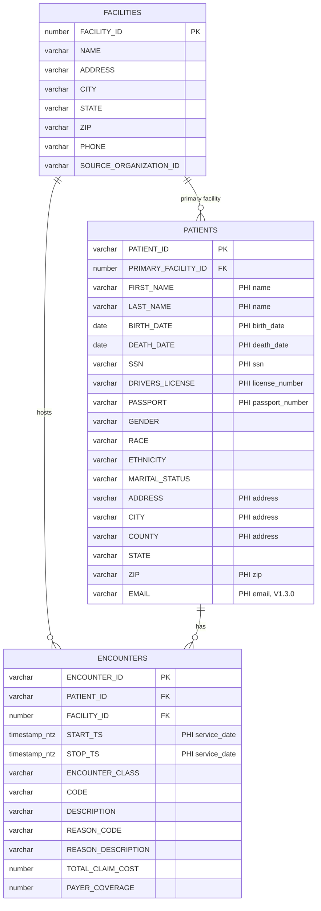
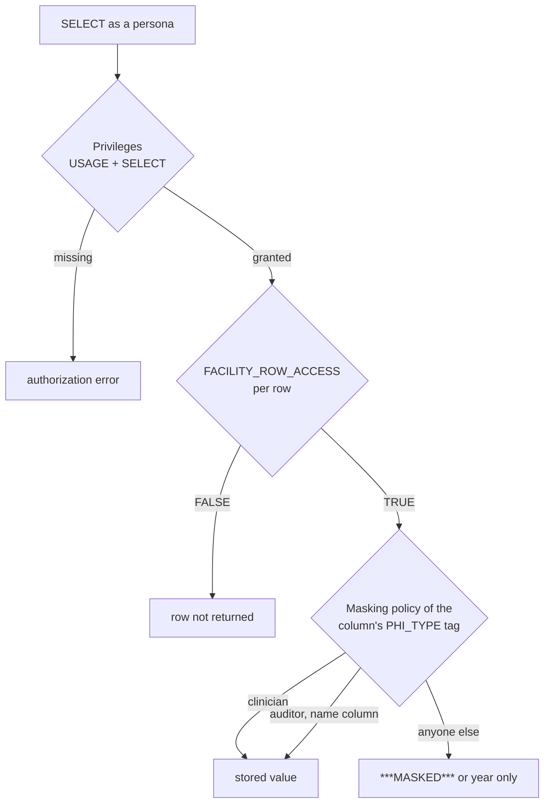

# PHI Guardrails: design notes

The README covers what the sample does and how to run it. This page records the data model and the design decisions behind the roles, policies and tests.

## Data model

The rows come from the Synthea April 2020 sample: three Massachusetts hospitals (facility ids 101, 102 and 103), their encounters since 2010, and the 156 patients seen there. A patient's primary facility is where most of their encounters took place. `PATIENT_ID` is a random surrogate key, not a medical record number, so it is not tagged.

Classification follows the HIPAA Safe Harbor identifier list: names, geography smaller than a state, all elements of dates except the year, SSN, licence and passport numbers, and email. Clinical codes and descriptions stay unmasked: on their own they identify nobody, and they are what analysts need.

## Layers of protection

A query passes three independent checks, so a mistake in one layer does not expose PHI.

| Role | `SELECT` on `PATIENTS`, `ENCOUNTERS` | `ANALYTICS` views | Rows let through | Masking |
| --- | --- | --- | --- | --- |
| `CLINICIAN` | yes | no | facility 101 | clear |
| `CLINICIAN_LEAD` | inherited | no | facilities 101 (inherited) and 102 | clear (inherited) |
| `AUDITOR` | yes | no | all | names clear, rest masked |
| `DATA_ENGINEER` | yes, plus `INSERT`, `UPDATE`, `DELETE`, `TRUNCATE` | no | none | masked |
| `ANALYST` | no | `SELECT` on both views | all, through the views only | masked |

Every role reads the facility directory (`CLINICAL.FACILITIES`, not PHI).

## Key design decisions

- **Facility roles carry row access.** Each facility has a `FACILITY_<id>` role, granted to the functional roles, and the row policy checks `IS_ROLE_IN_SESSION('FACILITY_' || facility_id)`. Who may see which facility is an ordinary grant, visible in `SHOW GRANTS` and reviewed like any other privilege. Persona sessions use their primary role only, so each test exercises exactly one role hierarchy.
- **`IS_ROLE_IN_SESSION`, not `CURRENT_ROLE()`.** It honours inheritance, so `CLINICIAN_LEAD` is treated as a clinician. The demo's broken policy shows what happens otherwise.
- **One tag, one policy per data type.** `GOVERNANCE.PHI_TYPE` uses `ALLOWED_VALUES` for a closed vocabulary and carries `PHI_MASK_STRING` (`VARCHAR`), `PHI_MASK_DATE` and `PHI_MASK_TIMESTAMP` (`TIMESTAMP_NTZ`). Classifying a new column of those types is the whole change (`V1.3.0`); a tagged column of any other type is caught by the coverage gate.
- **Masked dates keep the year.** Safe Harbor allows it, and it keeps year-level analytics such as `ENCOUNTER_SUMMARY` working. Auditors see names in clear so they can identify whose record was accessed.
- **The analyst passes the row policy but not the grants.** Secure views evaluate row policies as the querying role, so the policy lets analysts through and the missing `SELECT` grants keep them out of the raw tables. Masking is the third layer if a grant is ever added by mistake.
- **The data engineer writes but sees nothing.** Load jobs need `INSERT` and `TRUNCATE`, not readable PHI; the row policy hides every patient row from `DATA_ENGINEER`.
- **Policies are created once and altered in place.** Migrations use `CREATE ... IF NOT EXISTS` and change a policy with `ALTER MASKING POLICY ... SET BODY`, because an attached policy cannot be replaced (`003531`). Each column is classified in its own statement, so a diff shows exactly which classification changed.
- **Expectations never come from the policies.** The oracle computes visible rows from the persona's facilities in the contract, clear values from the Synthea rows, and masked values from the rule in the contract header. The two views are recomputed in Python, including the 11-patient suppression threshold. A policy bug cannot leak into the expectation.
- **The gate reads `INFORMATION_SCHEMA`.** `TAG_REFERENCES_ALL_COLUMNS` and `POLICY_REFERENCES` reflect a deploy immediately, whereas `ACCOUNT_USAGE` views have ingestion latency.
- **Every test session deploys from scratch.** The suite runs the real migrations into a fresh `PHI_TEST_<random>` database, so it tests the migrations themselves. schemachange runs with a scrubbed environment, so `SNOWFLAKE_*` variables in a developer's shell cannot redirect a deploy.

## Adapting it for production

- Split the deploy identity: `USERADMIN` / `SECURITYADMIN` for roles, users and grants, and a governance role that owns `GOVERNANCE` and holds `APPLY MASKING POLICY`, `APPLY ROW ACCESS POLICY` and `APPLY TAG`. The sample deploys as `ACCOUNTADMIN` to stay short.
- Persona users are test fixtures: grant the functional roles to people or groups through SCIM, and keep `PERSONA_*` users in the non-production account that runs the matrix.
- Run `make gate` after every deploy, and the matrix on every pull request that touches `migrations/` or `access-contract.yml`.
- Treat changes to `access-contract.yml` as access-rule changes and require a compliance reviewer on that path (for example with `CODEOWNERS`).
