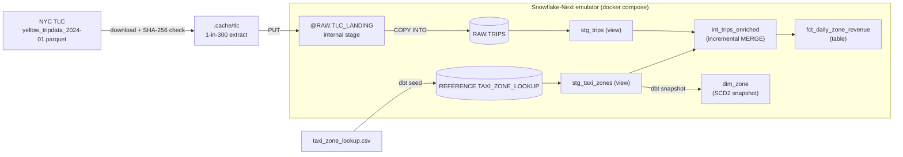
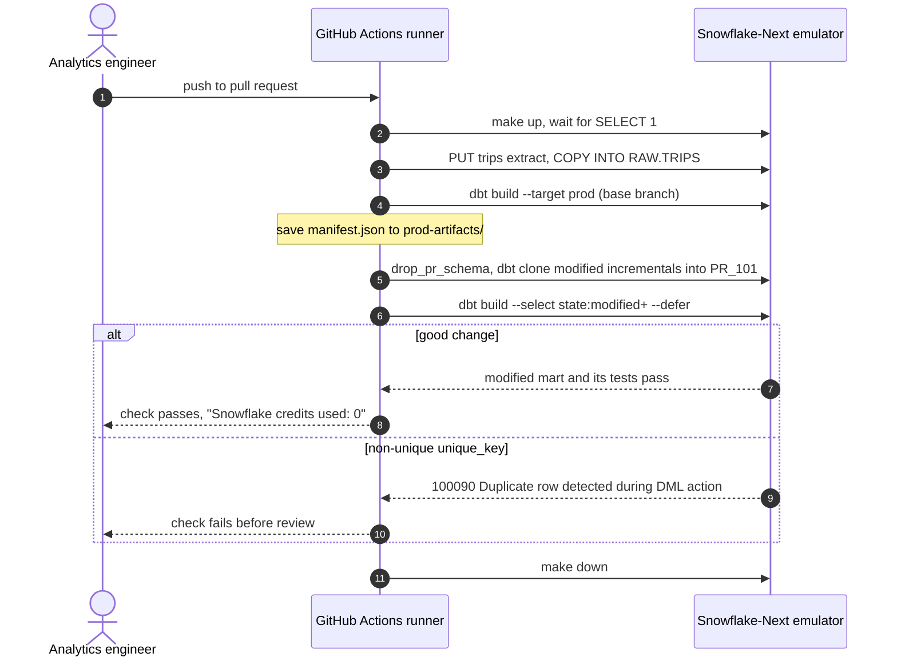

# Slim CI Lab

A dbt project with a complete Slim CI pull request pipeline (`state:modified+`, `--defer`, one schema per PR) that runs against the LocalStack Snowflake-Next emulator: no Snowflake credentials, 0 credits, and feedback in well under two minutes. It is for analytics engineers running dbt Core and GitHub Actions who want every pull request tested on a warehouse, including the "passes once, breaks on the second run" incremental `MERGE` bug.

## Architecture



The warehouse runs in one `localstack/snowflake-next` container. The loader and dbt run on the host or the CI runner and connect over HTTPS on `snowflake.localhost.localstack.cloud:4566` with key-pair (`SNOWFLAKE_JWT`) auth. Production state lives in the `STAGING`, `INTERMEDIATE`, `MARTS`, `SNAPSHOTS` and `REFERENCE` schemas, and each pull request builds into its own `PR_<number>` schema. Design notes are in [docs/architecture.md](docs/architecture.md).

## How it works

1. **Load raw data.** [`loader.py`](src/slim_ci_lab/loader.py) downloads one pinned month of NYC TLC trips, verifies its SHA-256, writes a deterministic 1-in-300 extract (9,883 rows), then runs `PUT` and `COPY INTO RAW.TRIPS ... MATCH_BY_COLUMN_NAME` with lineage columns. `COPY` load metadata makes the step idempotent.
2. **Build production state.** `dbt build --target prod` builds the seed, models and snapshot, runs the data and unit tests, and saves `manifest.json` to `prod-artifacts/`.
3. **Prepare the PR schema.** `drop_pr_schema` gives every push a clean `PR_<number>`, then `dbt clone` zero-copy clones modified incremental models from production, so the PR build runs the same `MERGE` production would.
4. **Build only what changed.** `dbt build --select state:modified+ --defer --state prod-artifacts` builds the modified models and their children; unmodified upstream models resolve to production.
5. **Summarize.** [`ci_summary.py`](src/slim_ci_lab/ci_summary.py) prints the nodes built and deferred, the wall-clock time and the credits used, and writes the same to the GitHub step summary.



## Prerequisites

- Docker with Compose v2
- [`uv`](https://docs.astral.sh/uv/) 0.10 or newer (installs Python 3.12 and the locked dependencies)
- `openssl`, `curl`, `patch` and GNU `make`
- A LocalStack auth token in `LOCALSTACK_AUTH_TOKEN` or `~/.localstack/default.env`
- Network access to `d37ci6vzurychx.cloudfront.net` on the first run (about 48 MB, cached under `.cache/`)

## Quickstart

```sh
make up        # key pair, emulator container, Python env, wait for SQL
make seed      # download, verify, downsample, PUT + COPY INTO RAW.TRIPS
make ci-local  # the full Slim CI pipeline, with demos/example-pr.patch as the PR
make demo      # a bad unique_key passes run 1 and fails the run 2 MERGE
make test      # the test suite (creates and drops its own database)
make down      # stop and remove the emulator
```

`make ci-local` ends with a summary like this:

```text
==> 5/5 Summary
PR schema:          pr_local
Selected:           fct_daily_zone_revenue
Nodes run:          1 model, 4 test, 1 unit_test
Results:            5 pass, 1 success
Deferred to prod:   19 of 25 nodes not rebuilt
Wall-clock:         0m 35s
Snowflake credits used: 0 (Snowflake-Next emulator)
```

Run the bad PR through the whole pipeline with `CI_PR_PATCH=demos/bad-unique-key.patch make ci-local`: it fails with `100090` on the first CI run. To use another host port, set `SNOWFLAKE_PORT` (for example `SNOWFLAKE_PORT=14566 make up test down`).

## Tests

`make test` runs pytest against the emulator in a throwaway `SLIM_CI_TEST_<random>` database. Expected values come from business rules or from pandas over the source file, never from the models. The suite covers:

- **Loading:** `COPY INTO` row counts and timestamps match the Parquet file, and a re-run loads 0 files.
- **Models:** revenue for one zone and day equals an independent pandas computation; a second incremental run merges without duplicates; the `dim_zone` snapshot records a renamed zone and a hard delete.
- **Slim CI:** the PR build selects only the modified mart and defers the rest; without `--defer` it fails with `002003`; a non-unique `unique_key` fails with `100090` on the second run and on the first CI run.
- **dbt unit tests:** two unit tests in [`dbt/models/schema.yml`](dbt/models/schema.yml) run inside every `dbt build`.

`make test-cloud` runs the same suite against a real Snowflake account (billable). Set `SNOWFLAKE_ACCOUNT`, `SNOWFLAKE_USER` and `SNOWFLAKE_PRIVATE_KEY_PATH`, and optionally `SNOWFLAKE_ROLE` (default `TRANSFORMER`) and `SNOWFLAKE_WAREHOUSE` (default `TRANSFORMING`); [`init/01_platform.sf.sql`](init/01_platform.sf.sql) creates the objects the role needs.

A copyable GitHub Actions workflow is in [`.github-example/workflows/dbt-ci.yml`](.github-example/workflows/dbt-ci.yml): the `slim-ci` job runs on every pull request with only the `LOCALSTACK_AUTH_TOKEN` secret, and the manual `parity` job runs the same pipeline on a real account.

## Project structure

```text
slim-ci-lab/
  Makefile                  up, seed, ci-local, demo, test, down, test-cloud
  docker-compose.yml        the emulator, bound to 127.0.0.1
  init/01_platform.sf.sql   warehouse, role, service user, database
  src/slim_ci_lab/          settings, TLC download, loader, demo, CI summary
  scripts/ci_local.sh       the Slim CI pipeline (make ci-local and GitHub Actions)
  dbt/                      models, macros, snapshot, seed, profiles
  demos/                    example-pr.patch (good PR), bad-unique-key.patch (bad PR)
  tests/                    pytest suite
  docs/architecture.md      design notes and data model
  .github-example/          copyable GitHub Actions workflow
```

## Learn more

- [dbt: node selection and state](https://docs.getdbt.com/reference/node-selection/syntax), [defer](https://docs.getdbt.com/reference/node-selection/defer), [dbt clone](https://docs.getdbt.com/reference/commands/clone)
- [dbt: incremental models](https://docs.getdbt.com/docs/build/incremental-models), [snapshots](https://docs.getdbt.com/docs/build/snapshots), [unit tests](https://docs.getdbt.com/docs/build/unit-tests)
- [Snowflake: COPY INTO \<table\>](https://docs.snowflake.com/en/sql-reference/sql/copy-into-table), [CREATE FILE FORMAT](https://docs.snowflake.com/en/sql-reference/sql/create-file-format)
- [Snowflake: MERGE](https://docs.snowflake.com/en/sql-reference/sql/merge), [CREATE ... CLONE](https://docs.snowflake.com/en/sql-reference/sql/create-clone)
- [NYC TLC trip record data](https://www.nyc.gov/site/tlc/about/tlc-trip-record-data.page)
