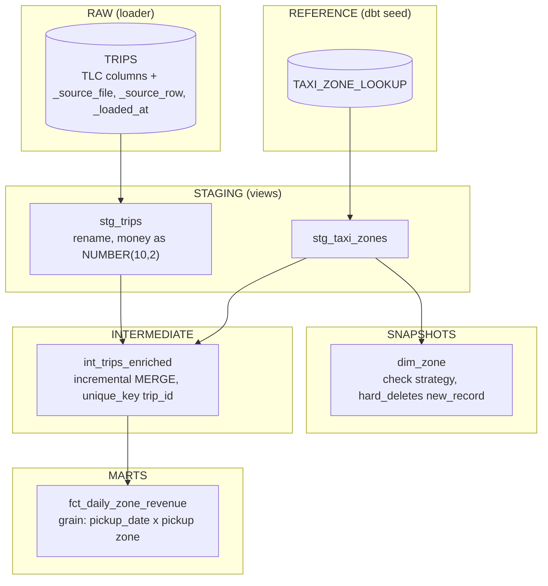
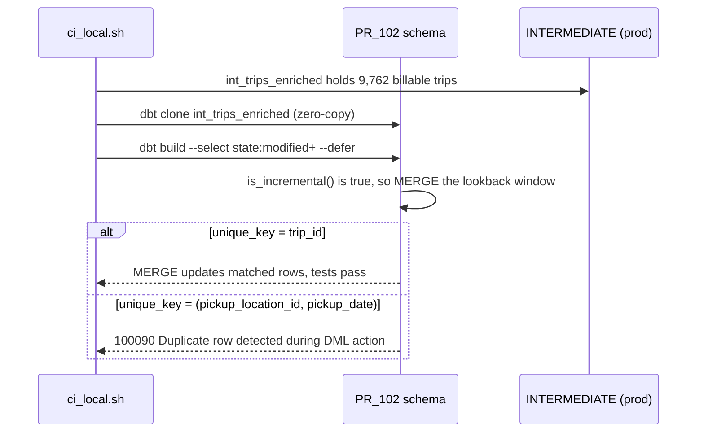

# Slim CI Lab: design notes

How data gets in, how the dbt project is layered, where each target builds, and why the pipeline catches a bad `unique_key` on the first CI run.

## Components

| Component | Runs where | Role |
| --- | --- | --- |
| `localstack/snowflake-next` | Docker, `127.0.0.1:${SNOWFLAKE_PORT}` | The warehouse: stages, tables, MERGE, CLONE, snapshots |
| `init/01_platform.sf.sql` | Inside the emulator at startup | What an admin provides: warehouse `TRANSFORMING`, role `TRANSFORMER`, user `SAMPLE_SVC`, database `SLIM_CI` |
| `slim_ci_lab.loader` | Host or CI runner | Download, verify, downsample, `PUT`, `COPY INTO` |
| dbt Core + dbt-snowflake | Host or CI runner | Models, tests, unit tests, snapshot, state comparison |
| `scripts/ci_local.sh` | Host or CI runner | The Slim CI pipeline; GitHub Actions runs the same script |

Compose binds the emulator to loopback only. Every client uses key-pair (`SNOWFLAKE_JWT`) auth with a throwaway key from `make up`, the same configuration a real account uses for service users.

## Data flow

- **Pinned input.** `tlc.py` names the exact URL and SHA-256 of `yellow_tripdata_2024-01.parquet`. A mismatch deletes the cached copy and fails.
- **Deterministic downsample.** The extract sorts by every column and keeps every 300th row (9,883 rows), so tests can compute expected values from the file.
- **Load.** `PUT ... OVERWRITE = FALSE`, then `COPY INTO RAW.TRIPS ... MATCH_BY_COLUMN_NAME = CASE_INSENSITIVE ON_ERROR = ABORT_STATEMENT` with `INCLUDE_METADATA` for lineage. The Parquet file format sets `USE_LOGICAL_TYPE = TRUE`, Snowflake's recommended setting for Parquet logical types such as timestamps.
- **Idempotency.** `COPY` load metadata means a second run reports `Copy executed with 0 files processed.`, so CI can retry the step.
- **Surrogate key.** TLC records have no id. `trip_id` is the MD5 of vendor, pickup and dropoff timestamps and zones plus `natural_key_seq`, a `row_number()` over those columns, so repeated records get distinct, stable keys.
- **Lookback window.** Incremental runs re-select trips from `max(pickup_at) - 3 days` (`var('incremental_lookback_days')`) and MERGE them on `trip_id`, so late or corrected trips update in place.

## Targets and schemas

`dbt/macros/generate_schema_name.sql` decides where each node lands:

| Target | Connection | `staging` model lands in | Purpose |
| --- | --- | --- | --- |
| `dev` | emulator | `DEV_<USER>_STAGING` | Personal sandbox |
| `prod` | emulator | `STAGING` | Production state that PRs defer to |
| `pr` | emulator | `PR_<DBT_PR_NUMBER>` | Every node of one PR in one schema |
| `cloud` | real account | `STAGING`, or `PR_<n>` when `DBT_PR_NUMBER` is set | The same workflow on Snowflake |

One schema per PR keeps isolation simple: two open PRs never write the same relation, and `drop_pr_schema` removes everything a PR created. Only the `cloud` target reads `SNOWFLAKE_ACCOUNT` and related variables, so a stray variable in a shell never redirects a local run to a billable account (`settings.py` follows the same rule).

## Why clone, then defer

Without the clone, a modified incremental model starts empty in the PR schema: dbt runs `CREATE TABLE AS`, every test passes, and the first `MERGE` happens in production. With a non-unique `unique_key`, each target row matches many source rows, and Snowflake rejects the nondeterministic MERGE (`ERROR_ON_NONDETERMINISTIC_MERGE` defaults to true). Cloning first makes the PR build run that MERGE.

`--defer` points `ref()` for unselected nodes at production. Without it, the PR build of `fct_daily_zone_revenue` references a missing `PR_<n>.INT_TRIPS_ENRICHED` and fails with `002003`; with it, the PR builds one table and reads everything else from production.

## Test isolation and security

- The pytest session creates `SLIM_CI_TEST_<random>`, builds production state in a temporary copy of the project, and drops the database at the end. No test or demo edits `dbt/`.
- The emulator listens on `127.0.0.1` only. `.secrets/` is gitignored and created with mode 700/600.
- The `parity` workflow job writes the real private key from a secret and runs in the `snowflake-parity` GitHub environment, so it can require approval.
- Statements carry `QUERY_TAG = 'slim-ci-lab'`, so CI load is easy to find in query history.
