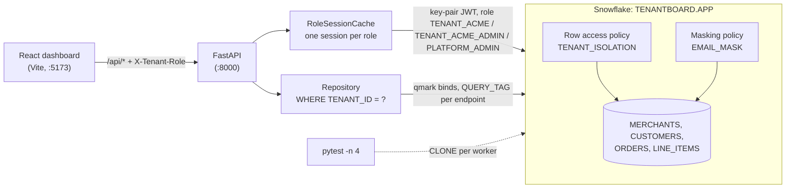
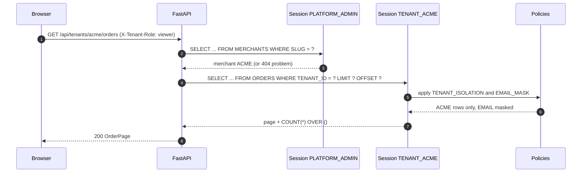

# Tenantboard

A multi-tenant analytics API (FastAPI + React) for a B2B commerce platform, where tenant isolation and PII masking are enforced by Snowflake row access and masking policies, and a leak test proves it on every run. It is for backend engineers who embed analytics in a SaaS product and want to test RBAC and policies locally, without a Snowflake account.

## Architecture



Isolation has two independent layers. The application binds the tenant in every query (`WHERE TENANT_ID = ?`), and each request runs in a Snowflake session under the tenant's own role, where the `TENANT_ISOLATION` policy shows only rows whose `TENANT_<ID>` role is in the session. A forgotten `WHERE` clause or a hand-written support query still cannot cross tenants. The test suite proves each layer on its own.

## How it works

1. **Roles are the tenant identity.** Provisioning (`app/provisioning.py`) creates `TENANT_<ID>` (viewer) and `TENANT_<ID>_ADMIN` (inherits the viewer role and `TENANT_ADMIN`) per merchant and grants both to the API's service user.
2. **Policies are attached at creation.** Every tenant table is created `WITH ROW ACCESS POLICY TENANT_ISOLATION ON (TENANT_ID)` (`init/03_tables.sf.sql`), so no table ever exists without its policy.
3. **One session per role.** `RoleSessionCache` (`app/db.py`) opens an async session per role on first use, shares it between requests and closes the least recently used one beyond a bound. The API never switches roles inside a session.
4. **Masking follows the role.** The same SQL returns `***MASKED***` for viewers and the email for admins; the API has no masking code.
5. **Uploads.** An admin's CSV is validated in pandas, staged with `write_pandas` into a temporary table and applied with one tenant-bound `MERGE`.
6. **Errors** are RFC 9457 problem details that keep the Snowflake error code, SQL state and query id.



## Prerequisites

- Docker with Compose v2
- [`uv`](https://docs.astral.sh/uv/) (installs Python 3.12 if needed)
- Node.js 22 with npm (for the dashboard)
- `openssl`, `make`, `curl`
- A LocalStack auth token, exported as `LOCALSTACK_AUTH_TOKEN` or stored in `~/.localstack/default.env`

## Quickstart

```sh
make up      # dev key pair, emulator, Python env; waits until tables, policies and grants exist
make seed    # 50 merchants: tenant roles, customers, orders, line items
make demo    # the leak test, narrated, on a throwaway clone
make run     # API on http://localhost:8000 (docs at /docs), dashboard on http://localhost:5173
make test    # the full suite, 4 workers, each on its own clone
make down    # stop and remove everything
```

If port 4566 is taken, set `SNOWFLAKE_PORT=14566` (or any free port) for every target.

With `make run` going, call the API directly. Requests run as the tenant's viewer role unless `X-Tenant-Role: admin` is sent:

```sh
curl -s localhost:8000/api/tenants/acme/summary
# {"tenant_id":"ACME","role":"viewer","snowflake_role":"TENANT_ACME","orders":24,"revenue":"12227.22",...}

curl -s "localhost:8000/api/tenants/acme/orders?page_size=1"
# {"items":[{"order_id":"ORD-000013","tenant_id":"ACME",...,"customer_email":"***MASKED***"}],"page":1,"page_size":1,"total":24}

curl -s -H 'X-Tenant-Role: admin' "localhost:8000/api/tenants/acme/orders?page_size=1"
# {"items":[{"order_id":"ORD-000013",...,"customer_email":"tara.chen.11@acme-buyers.example"}],...}

curl -s localhost:8000/api/tenants/nope/summary
# 404 {"type":"urn:tenantboard:problem:tenant-not-found","title":"Unknown tenant",...}
```

`make demo` runs a raw `SELECT * FROM ORDERS`, with no `WHERE` clause, under each role, then detaches the policy:

```text
[2/5] SELECT * FROM ORDERS   -- no WHERE clause, run under each role
      as TENANT_ACME          24 rows from  1 tenant(s): ACME
      as TENANT_GLOBEX        10 rows from  1 tenant(s): GLOBEX
      as TENANT_ACME_ADMIN    24 rows from  1 tenant(s): ACME
      as PLATFORM_ADMIN      698 rows from 50 tenant(s): ACME, AMBER_DEPOT, AMBER_STUDIO, ...
...
[4/5] ALTER TABLE ORDERS DROP ROW ACCESS POLICY TENANT_ISOLATION   -- simulate a missing policy
      as TENANT_ACME         698 rows from 50 tenant(s): ACME, AMBER_DEPOT, AMBER_STUDIO, ...   <-- LEAK: every tenant's orders
```

In the dashboard, pick a merchant and toggle **Viewer** / **Admin**: the orders and totals change with the tenant, and `customer_email` switches between `***MASKED***` and the address. `X-Tenant-Role` stands in for authentication; in production the tenant and role come from verified token claims.

## Tests

`make test` runs `pytest -n 4`. The controller builds a template database from `init/*.sf.sql` and the seeded dataset; each worker clones it, runs its own API instance against the clone and drops it at the end. Expected values are recomputed from the seed in plain pandas (`tests/helpers.py`), never read back from the API.

- **Leak test:** a raw `SELECT * FROM ORDERS` as a tenant role returns exactly that tenant's orders, and the same `SELECT` returns every tenant once the policy is detached.
- Every tenant table is filtered; the admin role inherits the isolation; `PLATFORM_ADMIN` sees all tenants; the app-layer filter isolates on its own.
- Email masking per role, summary, gap-filled daily revenue, top customers and pagination against the seed.
- CSV upload: inserts and updates only the caller's orders, is idempotent, and rolls back entirely on a `NOT NULL` violation.
- Error paths as problem details: unknown tenant (404), invalid input (422), viewer upload (403), unprovisioned tenant role (403, Snowflake `390189`).
- The per-role session cache: shared per role, bounded, never closes a leased session.

To run the same suite on a real account, run the account-level part of each `init/*.sf.sql` (above the `-- @deploy:` marker) once, then set `SNOWFLAKE_ACCOUNT`, `SNOWFLAKE_USER`, `SNOWFLAKE_ROLE` (with `CREATE DATABASE`, `CREATE ROLE` and `MANAGE GRANTS`), `SNOWFLAKE_WAREHOUSE` and `SNOWFLAKE_PRIVATE_KEY_PATH`, and run `make test-cloud`. This consumes credits.

## Project structure

```
tenantboard/
  Makefile, docker-compose.yml
  init/                 platform objects, policies, tables, grants (*.sf.sql)
  app/                  FastAPI app, session cache, repository, provisioning, uploads
  scripts/              seed, demo, run and readiness helpers
  web/                  React + Vite + TypeScript dashboard
  tests/                fixtures (template + clone per worker), oracle, test modules
  docs/architecture.md  data model, role model, test isolation, error catalog
```

## Learn more

- [Row access policies](https://docs.snowflake.com/en/user-guide/security-row-intro)
- [Masking policies](https://docs.snowflake.com/en/user-guide/security-column-ddm-intro)
- [`IS_ROLE_IN_SESSION`](https://docs.snowflake.com/en/sql-reference/functions/is_role_in_session)
- [Cloning considerations](https://docs.snowflake.com/en/user-guide/object-clone)
- [Python connector and `write_pandas`](https://docs.snowflake.com/en/developer-guide/python-connector/python-connector-pandas)
- [Key-pair authentication](https://docs.snowflake.com/en/user-guide/key-pair-auth)
