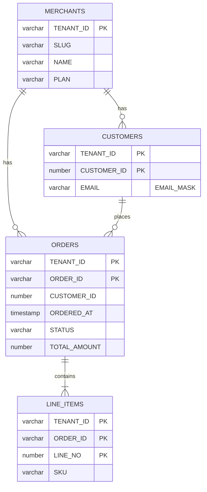
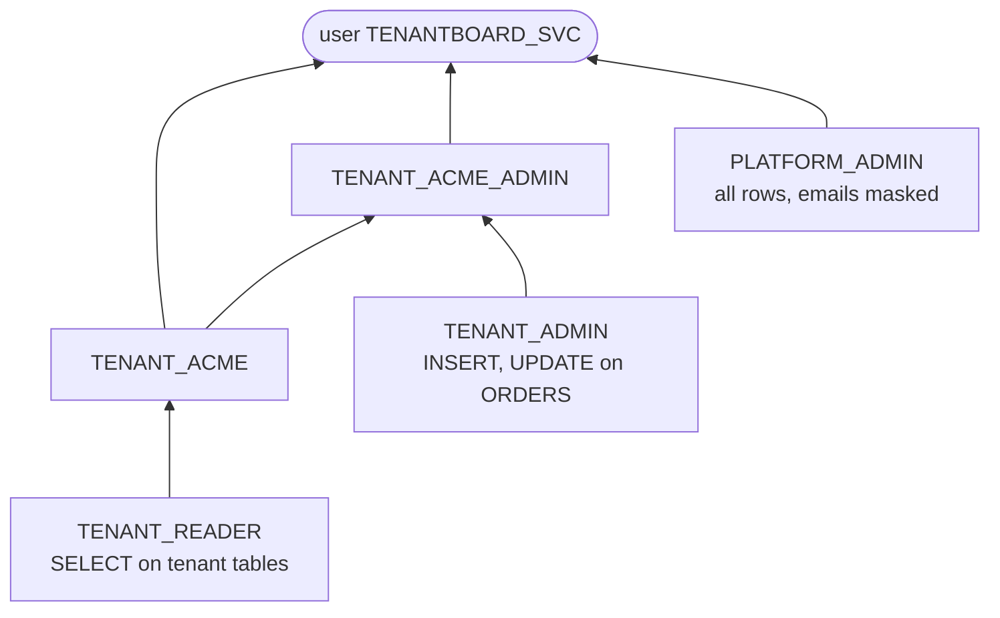
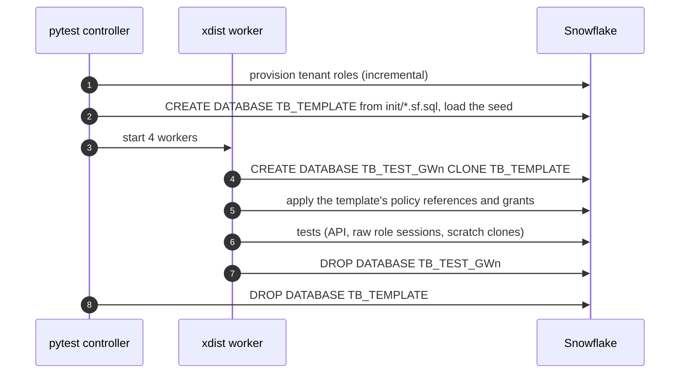

# Tenantboard architecture

Design notes behind the [README](../README.md): the data model, the role model the policies depend on, the request path, test isolation and the error contract.

## Data model

All tenant tables live in `TENANTBOARD.APP`, carry `TENANT_ID` and are created `WITH ROW ACCESS POLICY TENANT_ISOLATION ON (TENANT_ID)`. Keys are composite with `TENANT_ID` first: order ids are unique per tenant only (every merchant has an `ORD-000001`), which is why the upload's `MERGE` condition binds the tenant.

The seed (`scripts/seed.py`) is a pure function of `(seed, merchant count)`: 50 merchants, about 550 customers, 700 orders and 1,400 line items, so the tests can regenerate it and compute every expected value independently.

## Role model

Arrows point from a role to the role or user it is granted to. The policies key on role names, so the role is the entitlement and no lookup table is needed:

| Session role | Rows (`TENANT_ISOLATION`) | `EMAIL` (`EMAIL_MASK`) |
| --- | --- | --- |
| `TENANT_ACME` | ACME | `***MASKED***` |
| `TENANT_ACME_ADMIN` | ACME (inherited) | clear |
| `PLATFORM_ADMIN` | all tenants | `***MASKED***` |

**Naming invariant.** Because the policy derives the role name from the row's `TENANT_ID`, `app/tenancy.py` refuses tenant ids that would collide with another role: `ADMIN`, `READER` and anything ending in `_ADMIN`.

**Onboarding.** `provisioning.provision_tenants` creates both roles, wires the hierarchy and grants them to the service user in batched multi-statement requests. It is incremental, so a re-seed costs nothing.

## Request path

- **Identity.** A FastAPI dependency resolves the slug to a merchant through a `PLATFORM_ADMIN` session (the only cross-tenant query), maps `X-Tenant-Role` to `TENANT_<ID>` or `TENANT_<ID>_ADMIN`, and leases that role's session for the request.
- **Sessions.** `RoleSessionCache` keeps at most `TB_MAX_ROLE_CONNECTIONS` sessions (default 16), one per role, evicting the least recently used; a leased session is closed only when its lease ends. One session per role instead of `USE ROLE` per request means a failed request can never leave a shared session on the wrong tenant.
- **Statements.** All parameters are qmark binds. `QUERY_TAG` is set per statement (`tenantboard:<route>`), so concurrent requests share a session without `ALTER SESSION` races.
- **Result cache.** Sessions set `USE_CACHED_RESULT = TRUE`; each session is a single tenant role, so a reused result is always that tenant's own.

## Test isolation

Each worker database is provisioned from the template's `POLICY_REFERENCES` and grants file, so every test database carries exactly the protection production has. The step is driven by the template, not by a list in code: a policy missing from `init/` is missing from every clone, and the leak test fails.

Uploads write only to tenant `INITECH` with order ids unique per test, so tests are order-independent within a worker. Tests that modify policies work on their own scratch clones.

## Error catalog

Every error is `application/problem+json` with `type`, `title`, `status`, `detail` and `instance`. Snowflake errors add `snowflake: {error_code, sql_state, query_id}`.

| Status | `type` suffix | When |
| --- | --- | --- |
| 404 | `tenant-not-found` | No merchant with that slug |
| 422 | `invalid-request` | Path, query or header validation |
| 422 | `invalid-upload` | CSV header, types or duplicates |
| 422 | `constraint-violation` | Snowflake `100072`: `NULL` in a `NOT NULL` column; nothing applied |
| 403 | `admin-role-required` | Upload as viewer |
| 403 | `tenant-role-unavailable` | Snowflake `390189`: the tenant's role is not available to the service user |
| 403 | `not-authorized` | Snowflake `002003` / `003001` |
| 409 | `duplicate-merge-source` | Snowflake `100090`: several rows target one order |
| 413 | `upload-too-large` | Above `TB_MAX_UPLOAD_BYTES` |
| 502 | `snowflake-error` | Any other Snowflake error |
